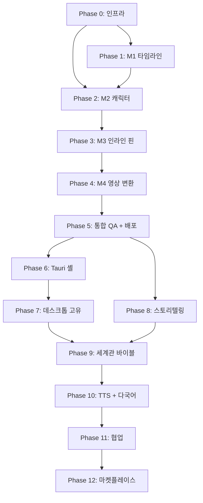

# AETHON — Roadmap (12 Phase)

> **버전**: 1.1
> **작성일**: 2026-04-20 / 업데이트: 2026-05-03
> **소유**: `product-lead` 에이전트
> **기간**: D+0 → D+160 (Post-MVP 완성)
> **상위 계약**: `CLAUDE.md`, `docs/PRD.md`, `docs/VISION.md`

---

## 0. 로드맵 개요

### 0.1 마일스톤 표

| Phase | 기간 | 시작일 | 종료일 | 책임 Lead | 주요 산출물 |
|---|---|---|---|---|---|
| **P0** | D+0 ~ D+7 | 2026-04-20 | 2026-04-27 | `desktop-qa-lead` + `data-lead` | 문서/에이전트 기반 완료 · 실행 골격은 2026-05-03 재착수 |
| **P0.5** | 2026-05-03 ~ | 2026-05-03 | TBD | `product-lead` + `fe-lead` + `data-lead` | 문서 동기화 + Cantos ADR/DDR + 모노레포/AI Control Center 스캐폴드 |
| **P1** | D+8 ~ D+20 | 재산정 필요 | 재산정 필요 | `fe-lead` + `fe-canvas` + `ai-prompt-engineer` | M0 AI Control Center + M1 타임라인 + 씬 구성 제안 |
| **P2** | D+21 ~ D+33 | 2026-05-11 | 2026-05-23 | `ai-consistency` + `fe-design` + `data-lead` | M2 캐릭터 카드 + IP-Adapter |
| **P3** | D+34 ~ D+44 | 2026-05-24 | 2026-06-03 | `fe-interactions` + `ai-consistency` | M3 인라인 핀 + 인페인팅 |
| **P4** | D+45 ~ D+54 | 2026-06-04 | 2026-06-13 | `ai-video-router` + `be-orchestrator` | M4 영상 변환 + Export |
| **P5** | D+55 ~ D+60 | 2026-06-14 | 2026-06-19 | `desktop-qa-lead` + `product-lead` | 통합 QA + Vercel Production + 외부 10명 |
| **P6** | D+61 ~ D+68 | 2026-06-20 | 2026-06-27 | `desktop-qa-lead` + `fe-lead` | Tauri 2.0 셸 + React 코어 래핑 |
| **P7** | D+69 ~ D+75 | 2026-06-28 | 2026-07-04 | `desktop-qa-lead` + `ai-video-router` | 데스크톱: 로컬 FS + 네이티브 FFmpeg + 멀티 윈도우 |
| **P8** | D+76 ~ D+95 | 2026-07-05 | 2026-07-24 | `storyboard-director` + `ai-prompt-engineer` | 스토리텔링 어시스턴트 (감정 곡선, 자동 시놉시스) |
| **P9** | D+96 ~ D+115 | 2026-07-25 | 2026-08-13 | `ai-consistency` + `data-lead` | 세계관 바이블 + 오브젝트 고정값 |
| **P10** | D+116 ~ D+135 | 2026-08-14 | 2026-09-02 | `fe-lead` + `legal-compliance` | TTS + 자막 + 다국어 + 법무 검토 |
| **P11** | D+136 ~ D+150 | 2026-09-03 | 2026-09-17 | `data-lead` + `fe-interactions` | 협업 모드 (Realtime + 댓글 + 버전) |
| **P12** | D+151 ~ D+160 | 2026-09-18 | 2026-09-27 | `product-lead` + `fe-design` | 템플릿 마켓플레이스 |

### 0.2 마일스톤 상태 정의

| 시점 | 정의 |
|---|---|
| **D+0** | Phase 0 시작. 사용자 4-Frame 확정 + CLAUDE.md + 23 에이전트 + 인사이트 파일 생성 완료. |
| **D+30** | M1 + M2 완료. 타임라인에 30개 씬 + 캐릭터 일관성 ≥ 0.80 검증. |
| **D+60** | **MVP 출시**. M1~M4 + Vercel Production + 외부 유저 10명 실사용. S1~S4 모두 측정 완료. |
| **D+90** | 데스크톱 출시 + 스토리텔링 어시스턴트 베타. P6~P8 완료. |
| **D+120** | 세계관 바이블 + TTS/다국어 베타. P9~P10 완료. |
| **D+160** | **Post-MVP 완성**. 협업 + 마켓플레이스까지 P11~P12 완료. 1주년 D+360 준비 시작. |

---

## 1. Phase 상세

### Phase 0 — 인프라 부트스트랩 (D+0 ~ D+7) — ✅ 진행 중

#### 목표
모노레포 + Supabase 스키마 + Vercel 프로젝트 + 23 에이전트 조직을 가동 상태로 만든다.

#### Entry Criteria
- 사용자 4-Frame(Why/What/How/So What) 확정.
- 13개 도메인 + 8 Evaluator + 4 Specialty 에이전트 구성 합의.
- 기술 스택(Next.js 16, Tauri 2.0, Vercel Fluid Compute) 확정.

#### Exit Criteria
- `pnpm install` 성공.
- `agents/AGENT_CONTRACT.md` 공용 에이전트/하네스 계약 + `.claude/agents/` 23개 Claude 호환 역할 파일.
- `docs/domain-knowledge/` 16개 인사이트 파일 (Phase 1 사전 시드 포함).
- 사업 문서 5건 (PRD/VISION/ROADMAP/플랜 보강/인사이트 시드) 완료.
- Git 초기 커밋 완료.

#### 책임 에이전트
- **Lead**: `product-lead` (조정), `desktop-qa-lead` (인프라), `data-lead` (스키마)
- **협업**: 23 에이전트 전원 (인사이트 파일 기록)

#### 주요 작업
1. 모노레포 스켈레톤 (apps/, packages/) 생성.
2. CLAUDE.md + agents/ + .claude/rules/ + .claude/agents/ 호환 경로 작성.
3. docs/PRD.md, VISION.md, ROADMAP.md 작성.
4. 16 인사이트 파일 사전 지식 시드 추가.
5. .claude/plans/ai-typed-dusk.md 보강.
6. 사업계획서 (HTML IR 풀스택).
7. Git 초기 커밋.

#### 의존
없음 (시작 Phase).

#### 리스크
| 리스크 | 영향 | 확률 | 완화 |
|---|---|---|---|
| Iron Law 훅이 일반 작업 차단 | High | Med | allowlist 정비, 사전 record-agent-call.sh 호출 |
| 23 에이전트 정의 충돌 | Med | Low | `coherence-reviewer` 사전 검수 |
| 사업 문서 분량 폭증 | Low | Med | CE 원칙 적용, 적정 고도 유지 |

---

### Phase 1 — M1 타임라인 + 씬 카드 (D+8 ~ D+20)

#### 목표
기획표/스크립트 입력 → AI가 씬 구성을 제안 → 사용자가 승인/수정 → 30개 씬 카드를 타임라인에 배치 → 드래그 순서 변경 → 클릭 시 우측 프리뷰와 AI 제안 패널 표시.

#### Entry Criteria
- Phase 0 완료 (인프라 가동).
- Supabase scenes 테이블 마이그레이션 적용.
- Claude Sonnet 4.6 API 키 + Vercel AI Gateway 설정.

#### Exit Criteria
- AC-M1-1 ~ AC-M1-6 모두 통과.
- 씬 구성 제안 30초 이내 완료.
- AI Control Center에서 전역 Auto / Adviser / Off와 작업별 상세 모드 설정 가능.
- 30 씬 타임라인 60fps 드래그.
- Playwright E2E: 프로젝트 생성 → 씬 분할 → 드래그 통과.

#### 책임 에이전트
- **Lead**: `fe-lead`
- **협업**: `fe-canvas` (Konva), `ai-prompt-engineer` (Sonnet 씬 분할), `data-lead` (스키마), `be-orchestrator` (Server Action), `prompt-linter` (검증)

#### 주요 작업
1. Next.js 16 App Router 라우트 (`(studio)/page.tsx`).
2. Konva Stage + Timeline 컴포넌트 (가상화 포함).
3. 씬 카드 드래그 (dnd-kit) + duration 인라인 편집.
4. AI Control Center UI + `ai_preferences` / `ai_suggestions` 데이터 연결.
5. Server Action `suggestScenesAction` (Sonnet + Prompt Caching).
6. 우측 프리뷰 패널 (Suspense + 스트리밍).
7. 줌 인/아웃 + 키보드 네비게이션.
8. E2E 테스트 (Playwright).

#### 의존
- Phase 0 (스키마, 인프라).
- 동시 진행 가능: Phase 2의 데이터 스키마 추가 필드 (병렬 Pull Request).

#### 리스크
| 리스크 | 영향 | 확률 | 완화 |
|---|---|---|---|
| Konva 30+ 노드 성능 저하 | High | Med | 가상화 패턴, GPU 가속 활용 |
| 씬 분할 토큰 비용 폭증 | Med | High | Prompt Caching으로 시스템 프롬프트 캐시, max_tokens 제한 |
| 드래그 좌표 동기화 버그 | Med | Med | dnd-kit 공식 패턴 준수, 단위 테스트 |

---

### Phase 2 — M2 캐릭터 카드 + IP-Adapter (D+21 ~ D+33)

#### 목표
캐릭터 외형 + 레퍼런스 이미지 등록 → 모든 씬 생성 시 IP-Adapter 적용 후보 제안/승인 → 동일 캐릭터 10 씬 코사인 유사도 ≥ 0.80 (S1).

#### Entry Criteria
- Phase 1 완료.
- characters 테이블 + Vercel Blob 설정.
- fal.ai API 키 + FLUX + IP-Adapter 모델 검증.

#### Exit Criteria
- AC-M2-1 ~ AC-M2-5 통과.
- S1 측정: 동일 캐릭터 10 씬 코사인 유사도 평균 ≥ 0.80.
- 5명 캐릭터 동시 등록 + 다중 선택 동작.

#### 책임 에이전트
- **Lead**: `ai-consistency`
- **협업**: `fe-design` (카드 UI), `data-lead` (RLS), `ai-output-validator` (S1 측정), `cost-monitor`

#### 주요 작업
1. 캐릭터 카드 UI (shadcn/ui + Claude Design).
2. 레퍼런스 이미지 업로드 (Vercel Blob private + Signed URL).
3. fal.ai FLUX + IP-Adapter 어댑터 (`packages/ai/image/fal-flux/`).
4. 자동 프롬프트 합성 엔진 (`packages/core/prompt-engine/`).
5. 5개 이미지 모델 라우터 v1 (FLUX 기본, 점진 추가).
6. 일관성 측정 스크립트 (`scripts/measure-consistency.ts`).
7. RLS 정책 + Storage 보안.

#### 의존
- Phase 1 (씬 데이터).
- 동시 진행 가능: Phase 3의 인페인팅 사전 R&D.

#### 리스크
| 리스크 | 영향 | 확률 | 완화 |
|---|---|---|---|
| IP-Adapter 가중치 튜닝 실패 | High | Med | 0.6/0.7/0.8 3가지 프리셋 실험, A/B 테스트 |
| FLUX API 응답 시간 > 30s | Med | Med | 큐 + 진행률 표시, 폴백 모델 |
| 비인간 캐릭터 일관성 약함 | Med | High | MVP는 인간 캐릭터 우선, 비인간은 OOS-14 |

---

### Phase 3 — M3 인라인 핀 + 인페인팅 (D+34 ~ D+44)

#### 목표
이미지에서 영역 드래그 → 댓글 입력 → FLUX Fill 인페인팅 → 비교 슬라이더로 결과 확인. 평균 재시도 ≤ 2.5회 (S3).

#### Entry Criteria
- Phase 2 완료.
- FLUX Fill API + Nano Banana Edit API 검증.

#### Exit Criteria
- AC-M3-1 ~ AC-M3-6 통과.
- S3 베타 측정: 평균 재시도 ≤ 2.5회.
- 5개 핀 동시 처리 + 히스토리 되돌리기.

#### 책임 에이전트
- **Lead**: `fe-interactions`
- **협업**: `ai-consistency` (FLUX Fill), `fe-design` (비교 슬라이더), `ai-output-validator` (S3)

#### 주요 작업
1. 영역 드래그 컴포넌트 (Konva 또는 SVG).
2. 좌표 정규화 ({ x, y, w, h } 0~1).
3. inpaint_pins JSONB 저장 + 히스토리.
4. FLUX Fill 어댑터 (마스크 블러 + IP-Adapter 동시).
5. 비교 슬라이더 컴포넌트 (Framer Motion).
6. Server Action `inpaintScenePin` + 큐 처리.

#### 의존
- Phase 2 (이미지 생성 + 캐릭터 카드).

#### 리스크
| 리스크 | 영향 | 확률 | 완화 |
|---|---|---|---|
| 영역 외 픽셀 영향 | High | Med | 마스크 블러, 다중 모델 비교 |
| 좌표 정규화 버그 | Med | Low | 단위 테스트 + Playwright |
| S3 ≤ 2.5회 미달성 | Med | Med | 핀 UX 개선 라운드 추가 |

---

### Phase 4 — M4 영상 변환 + Export (D+45 ~ D+54)

#### 목표
씬 이미지 → 영상 클립(3~10초) → 9 모델 추천 카드 + 사용자 승인/수동 오버라이드/명시 Auto 정책 → 30 씬 결합 → MP4 Export.

#### Entry Criteria
- Phase 3 완료.
- Runway + Kling + Seedance 최소 3개 영상 모델 API 키.
- FFmpeg.wasm 또는 네이티브 FFmpeg 통합.

#### Exit Criteria
- AC-M4-1 ~ AC-M4-6 통과.
- 30 씬 영상 변환 + MP4 1080p Export 성공.
- 모델 추천 카드 + 사용자 승인 + 수동 오버라이드 + 명시 허용된 Auto 실행 동작.
- 비용 사전 표시 (`cost-monitor`).

#### 책임 에이전트
- **Lead**: `ai-video-router`
- **협업**: `be-orchestrator` (큐), `desktop-qa-lead` (FFmpeg), `cost-monitor`, `ai-output-validator`

#### 주요 작업
1. 9개 영상 모델 어댑터 (`packages/ai/video/*/`). MVP는 3개 우선.
2. 씬 → 모델 추천 정책 (`packages/ai/router/select-model.ts`): 1순위 후보, 대체 모델, 비용/권리/품질 리스크 산출.
3. 모델 칩 UI + 드롭다운 + 추천 이유/비용/리스크 툴팁.
4. Vercel Queues 작업 큐 + 진행률 Realtime.
5. 폴백 + 재시도 정책.
6. FFmpeg.wasm 결합 + MP4 1080p Export.
7. 비용 추정 + 표시.

#### 의존
- Phase 3 (이미지 완성).

#### 리스크
| 리스크 | 영향 | 확률 | 완화 |
|---|---|---|---|
| Sora 2 등 일부 모델 접근 제한 | Med | High | 3개 시작, 점진 추가, OOS-11/12 |
| 영상 변환 비용 폭증 | High | High | `cost-monitor` 사전 알림, 사용자 확인 |
| FFmpeg.wasm 메모리 한계 | Med | Med | 30 씬 / 1080p 한계 검증, 데스크톱 폴백 |

---

### Phase 5 — 통합 QA + 웹 배포 (D+55 ~ D+60)

#### 목표
M1~M4 통합 → S1~S4 측정 → Vercel Production 배포 → 외부 유저 10명 가입 + 사용.

#### Entry Criteria
- Phase 1~4 모두 완료.
- 모든 AC 통과.

#### Exit Criteria
- 수용 기준 종합 (PRD §5) 모두 ✅.
- S1 ≥ 0.80 / S2 ≤ -70% / S3 ≤ 2.5회 / S4 D+60.
- Vercel Production 배포.
- 10명 외부 유저 가입 + 1+ 프로젝트 생성.
- Sentry + Vercel Analytics 활성화.

#### 책임 에이전트
- **Lead**: `desktop-qa-lead`, `product-lead`
- **협업**: 8 Evaluator 전원, `devops-ci`, `observability-lead`, `security-auditor`

#### 주요 작업
1. Playwright 풀 시나리오 E2E.
2. S1~S3 측정 스크립트 + 결과 정리.
3. 보안 감사 (security-auditor + OWASP Top 10).
4. 비용 감사 (cost-monitor + 30일 사용량 추정).
5. 법무 검토 (legal-compliance + AI 생성물 권리 고지).
6. CE 검토 (ce-reviewer + 문서 품질).
7. Vercel Production 배포 + 도메인.
8. 외부 유저 10명 모집 + 온보딩.

#### 의존
- Phase 1~4 전체.

#### 리스크
| 리스크 | 영향 | 확률 | 완화 |
|---|---|---|---|
| S1~S4 미달성 | Critical | Med | Phase별 사전 측정, 미달 시 1주 버퍼 |
| 보안/법무 이슈 발견 | High | Low | Phase 4 중간 사전 검토 |
| 외부 유저 모집 실패 | High | Med | 한국/일본 커뮤니티 사전 시딩 |

---

### Phase 6 — Tauri 2.0 데스크톱 셸 (D+61 ~ D+68)

#### 목표
웹 코어를 Tauri 2.0 셸로 래핑 → 동일 UI를 데스크톱 바이너리로 제공.

#### Entry Criteria
- Phase 5 완료 (웹 안정).
- Tauri 2.0 + React 19 호환성 fact-checker 검증.

#### Exit Criteria
- macOS + Windows 바이너리 빌드 성공.
- 웹과 동일한 UI 표시.
- 로컬 `.aethon` 프로젝트 파일 저장/로드.

#### 책임 에이전트
- **Lead**: `desktop-qa-lead`
- **협업**: `fe-lead`, `devops-ci`, `fact-checker`

#### 주요 작업
1. Tauri 2.0 셸 셋업 (`apps/desktop/`).
2. React 코어 재사용 (`packages/ui/` import).
3. fs-tauri 어댑터 (`packages/adapters/fs-tauri/`).
4. GitHub Actions Tauri 빌드 매트릭스.
5. 자동 업데이트 (Tauri Updater).
6. 코드 사이닝 (macOS/Windows).

#### 의존
- Phase 5.

#### 리스크
| 리스크 | 영향 | 확률 | 완화 |
|---|---|---|---|
| Tauri 2.0 + React 19 호환성 | High | Med | fact-checker 사전 검증, 패치 릴리스 추적 |
| 코드 사이닝 비용/지연 | Med | High | Apple Developer + Microsoft Authenticode 사전 등록 |

---

### Phase 7 — 데스크톱 고유 기능 (D+69 ~ D+75)

#### 목표
로컬 GPU(ComfyUI 연동) + 네이티브 FFmpeg + 멀티 윈도우 + 오프라인 모드.

#### Entry Criteria
- Phase 6 완료.

#### Exit Criteria
- 네이티브 FFmpeg로 4K MP4 Export 성공.
- 멀티 윈도우(타임라인 + 프리뷰 분리) 동작.
- 로컬 ComfyUI 연동 옵션 (선택적).

#### 책임 에이전트
- **Lead**: `desktop-qa-lead`
- **협업**: `ai-video-router`, `fe-canvas`

#### 주요 작업
1. render-native 어댑터 (네이티브 FFmpeg Rust 바인딩).
2. 멀티 윈도우 (Tauri Window API).
3. 로컬 ComfyUI 연동 옵션.
4. Playwright 다중 윈도우 테스트.

#### 의존
- Phase 6.

#### 리스크
| 리스크 | 영향 | 확률 | 완화 |
|---|---|---|---|
| 네이티브 FFmpeg 빌드 복잡 | Med | High | sidecar 패턴, 사전 빌드 바이너리 |
| 멀티 윈도우 상태 동기화 | Med | Med | Zustand cross-window 채널 |

---

### Phase 8 — 스토리텔링 어드바이저 (D+76 ~ D+95)

#### 목표
스토리 분석 제안 → 감정 곡선 시각화 → 시놉시스 후보 → 3막/Kishōtenketsu 구조 검증. 사용자가 구조 제안을 승인/수정한다.

#### Entry Criteria
- Phase 7 완료 + `storyboard-director` 에이전트 성숙.

#### Exit Criteria
- 30 씬 → 감정 곡선 차트 후보 생성.
- 시놉시스 후보 (300자 이내).
- 3막/Kishōtenketsu 검증 점수.

#### 책임 에이전트
- **Lead**: `storyboard-director`
- **협업**: `ai-prompt-engineer`, `fe-design`

#### 주요 작업
1. 감정 곡선 분석 제안 (Sonnet + 씬 emotion 시계열).
2. 시놉시스 후보 생성.
3. 3막 구조 검증 룰셋.
4. Kishōtenketsu 옵션 (일본 시장).
5. 시각화 차트 (Recharts).

---

### Phase 9 — 세계관 바이블 + 오브젝트 고정값 (D+96 ~ D+115)

#### 목표
world_bible 에디터 + 오브젝트(소품/탈것/건물) 고정값 + 캐릭터 외 자산 일관성.

#### Entry Criteria
- Phase 8 완료.
- M2 (캐릭터 일관성) 패턴이 다른 자산에도 적용 가능함 검증.

#### Exit Criteria
- world_bible 에디터(Tiptap 기반).
- 오브젝트 카드 (캐릭터와 동일 IP-Adapter 패턴).
- 동일 오브젝트가 여러 씬에 일관되게 등장.

#### 책임 에이전트
- **Lead**: `ai-consistency`, `data-lead`
- **협업**: `fe-design`, `legal-compliance`

#### 주요 작업
1. world_bible 에디터.
2. objects 테이블 (characters와 유사).
3. 오브젝트 카드 UI.
4. 자동 프롬프트 합성에 오브젝트 주입.

---

### Phase 10 — TTS + 자막 + 다국어 + 법무 검토 (D+116 ~ D+135)

#### 목표
ElevenLabs TTS 통합 + 자동 자막 + 한/일/중/영 4개 언어 UI + AI 생성물 법무 검토.

#### Entry Criteria
- Phase 9 완료.
- next-intl 인프라.
- ElevenLabs API 키.

#### Exit Criteria
- 4개 언어 UI 전환 동작.
- TTS 음성 생성 + 영상 결합.
- 자동 자막 (음성 → SRT).
- 법무 검토 통과 (AI 생성물 권리 고지, EU AI Act 대응).

#### 책임 에이전트
- **Lead**: `fe-lead`
- **협업**: `legal-compliance`, `ai-prompt-engineer`, `ce-reviewer`

#### 주요 작업
1. next-intl 셋업 + 4개 언어 번역.
2. ElevenLabs 어댑터.
3. 자동 자막 (Whisper API).
4. 법무 문서 (Terms / Privacy / AI 생성물 고지).
5. EU AI Act 대응 (생성물 워터마크).

---

### Phase 11 — 협업 모드 (D+136 ~ D+150)

#### 목표
Supabase Realtime → 실시간 댓글 + 다중 사용자 편집 + 버전 히스토리.

#### Entry Criteria
- Phase 10 완료.

#### Exit Criteria
- 2명 동시 편집 + 충돌 해결.
- 인라인 핀에 댓글 스레드.
- 버전 히스토리 + 롤백.

#### 책임 에이전트
- **Lead**: `data-lead`
- **협업**: `fe-interactions`, `be-orchestrator`, `security-auditor`

#### 주요 작업
1. Supabase Realtime 채널 (씬 단위).
2. 충돌 해결 (last-write-wins + CRDT 검토).
3. 댓글 스레드.
4. 버전 히스토리.

---

### Phase 12 — 템플릿 마켓플레이스 (D+151 ~ D+160)

#### 목표
캐릭터/세계관/템플릿 거래 시장 베타 + 결제 + 30% 수수료.

#### Entry Criteria
- Phase 11 완료.
- 결제 프로바이더(Stripe) 통합.

#### Exit Criteria
- 무료 템플릿 50개 시드.
- 결제 + 수수료 정산.
- 콘텐츠 모더레이션(법무).

#### 책임 에이전트
- **Lead**: `product-lead`
- **협업**: `fe-design`, `legal-compliance`, `security-auditor`

#### 주요 작업
1. 마켓플레이스 UI.
2. Stripe Connect (창작자 정산).
3. 콘텐츠 모더레이션.
4. 검색/필터.

---

## 2. 리스크 등록부 (Risk Register)

### Top 5 Risk

| # | 리스크 | 영향도 | 발생확률 | 완화 전략 | 담당 |
|---|---|---|---|---|---|
| **R1** | S1(캐릭터 일관성 0.80) 미달성 | Critical | Med | Phase 2 중간 측정, IP-Adapter 가중치 A/B, 폴백으로 ControlNet 추가 | `ai-consistency` + `ai-output-validator` |
| **R2** | AI 비용 폭증 (월 추정 비용 초과) | High | High | Vercel AI Gateway 비용 추적, `cost-monitor` 알림, MVP는 무료 베타로 학습 | `cost-monitor` + `be-orchestrator` |
| **R3** | 9개 영상 모델 중 일부 접근 제한 (Sora 2 등) | Med | High | 3개 시작 (Runway/Kling/Seedance), 나머지 점진. OOS-11에 명시 | `ai-video-router` |
| **R4** | Tauri 2.0 + React 19 호환성 문제 | High | Med | Phase 6 시작 전 fact-checker 검증, Tauri patch 릴리스 추적 | `desktop-qa-lead` + `fact-checker` |
| **R5** | 외부 베타 유저 10명 모집 실패 | High | Med | 한국/일본 커뮤니티 (디스코드, 트위터) 사전 시딩, P5 시작 1주 전부터 모집 | `product-lead` |

### 추가 리스크 (Med 이하)

- **R6** Konva 30+ 노드 성능 저하 → 가상화로 완화.
- **R7** EU AI Act 일정에 따른 워터마크 의무 → P10에서 대응.
- **R8** Vercel Fluid Compute 300s 타임아웃 초과 작업 → Vercel Queues로 분리.
- **R9** Supabase RLS 누락 → `security-auditor` 자동 검증.
- **R10** 9개 영상 모델 단가/품질 변동 → 라우팅 룰 분기점에 fact-checker 정기 갱신.

---

## 3. Phase 의존 그래프

### 동시 진행 가능 (Parallelizable)

- **P1 ↔ P2 일부**: P1 후반부터 P2 데이터 스키마 PR 병렬.
- **P5 ↔ P8 사전 R&D**: 통합 QA 중에도 storyboard-director가 P8 사전 분석 수행 가능.
- **P10 ↔ P11**: TTS와 협업은 독립 도메인. 인력 분배 시 병렬 가능.

### 절대 직렬 (Strict Sequence)

- **P0 → P1 → P2 → P3 → P4 → P5**: MVP 핵심 흐름. 각 Phase 완료 없이 다음 진입 불가.
- **P6 → P7**: Tauri 셸 없이 데스크톱 고유 기능 불가.
- **P9 → P10**: 세계관 바이블 안정화 후 다국어 진행.

---

## 4. 외부 의존 항목

### 4.1 클라우드 / 인프라

| 의존 | 대안 | 리스크 |
|---|---|---|
| **Vercel** (Fluid Compute, Queues, Blob, AI Gateway) | AWS Lambda / Cloudflare Workers | Med — 단일 벤더 락인. 마이그레이션 비용 평가 정기적. |
| **Supabase** (Postgres, Storage, Realtime) | 자체 Postgres + S3 | Med — RLS 패턴 이식성 검토. |
| **Clerk** (Auth, Marketplace 통합) | Auth0 / 자체 인증 | Low — Auth.js로 마이그레이션 가능. |

### 4.2 AI 프로바이더

| 의존 | 강점 | 리스크 |
|---|---|---|
| **Anthropic Claude Sonnet 4.6** | 씬 분할 + 라우팅 판단 | Low — Vercel AI Gateway로 OpenAI/Gemini 폴백. |
| **fal.ai (FLUX, FLUX Fill, IP-Adapter)** | 일관성 핵심 | High — 단가/스펙 변동, 대안 (Replicate) 모니터링. |
| **Runway Gen-3** | 시네마틱 영상 | High — 5초 제한, 비쌈, 정책 변경 가능. |
| **Kling 2.0** | 긴 영상 | Med — 한·중 정책 차이. |
| **Veo 3 / Sora 2** | 최고 품질 | High — 접근 제한. MVP에서는 OOS-11. |
| **Seedance / Pika / Hailuo / Luma / Grok** | 다양한 강점 | Med — 점진 추가. |

### 4.3 라이브러리

| 의존 | 버전 검증 시점 |
|---|---|
| **Next.js 16** | Phase 0 fact-checker, Phase 6 재검증 |
| **React 19** | Phase 0 + Phase 6 (Tauri 호환성) |
| **Tauri 2.0** | Phase 6 시작 전 fact-checker |
| **Konva.js** | Phase 1 |
| **Supabase JS SDK** | Phase 0 |

---

## 5. 변경 이력

| 일자 | 버전 | 변경 | 작성 |
|---|---|---|---|
| 2026-04-20 | 1.0 | 초기 12 Phase 로드맵 + 리스크 + 외부 의존. | `product-lead` |
| 2026-05-03 | 1.1 | AI-native NLE 목표, Adviser-first 제어 철학, Cantos ADR/DDR, P0.5 모노레포/AI Control Center 스캐폴드 반영. | `product-lead` |

---

## 6. 참조

- 상위 플랜: `.claude/plans/ai-typed-dusk.md`
- PRD: `docs/PRD.md`
- 비전: `docs/VISION.md`
- 에이전트 매트릭스: `.claude/rules/agent-matrix.md`
## 2026-05-03 Loop 2 Update: Production Readiness Gates

- `P0.5` now includes the verified production-readiness layer, not only the editor workspace shell.
- Added core contracts for `SceneSpec`, provider capability versions, validation reports, cost ledger entries, rights manifest entries, and export readiness.
- Verified evidence: `pnpm --filter @aethon/core test` 17 passed, `pnpm typecheck` 4 packages passed, `pnpm build` 4 packages passed, Playwright console errors 0.
- Cantos DDR: `0019-loop2-production-readiness-gates.html`.
- Phase 1/4 must persist these contracts in Supabase before real provider execution: `scene_specs`, `provider_capability_versions`, `validation_reports`, `cost_ledger_entries`, `rights_manifest_entries`.
