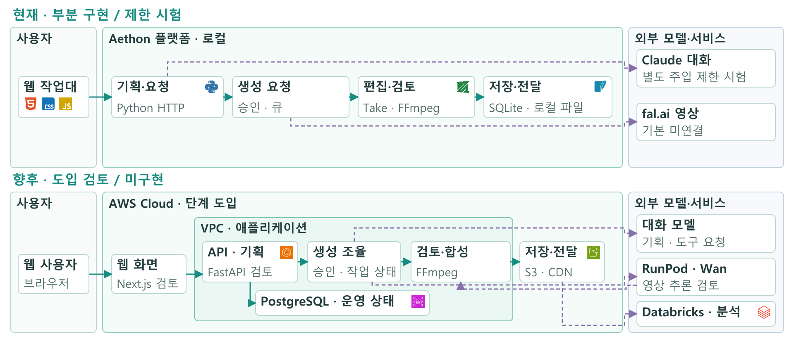
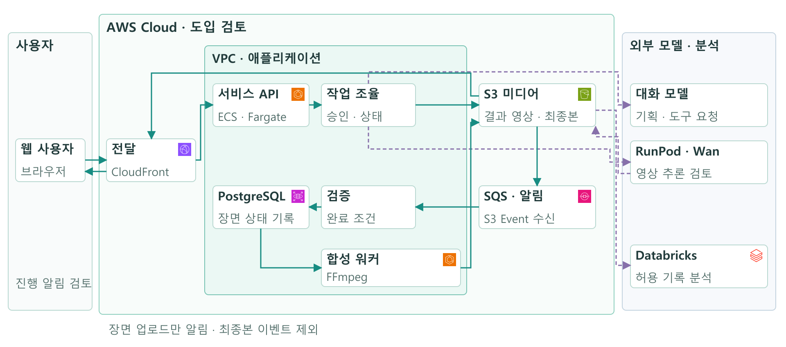
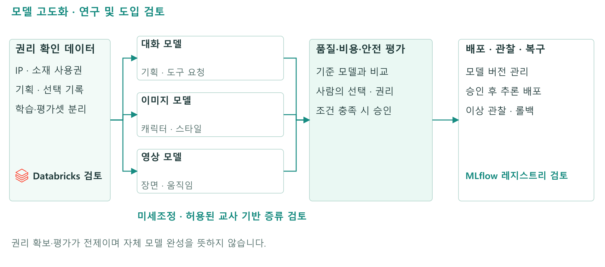

# Aethon 상세 사업계획서

AI·음악영상 제작 스튜디오, 레이블·기획사 콘텐츠팀, 웹툰·서브컬처 IP 스튜디오를 위한 음악영상 제작 작업대

작성 기준일 2026년 10월 28일  |  대표 이성민  |  RealizeSoft 현실화하는소프트  |  검토용 초안

이 문서는 현재 Aethon의 사업 방향, 제품 개발 상태, 시장 접근 방법과 사업화 검증 계획을 상세히 설명한다. 2026년 창업아이디어 경진대회 발표자료 v7과 같은 대표 정보·기술 구분을 사용한다(타깃은 아래 2026-10-28 개정을 따른다). 제출 기관의 사업계획서 서식이나 분량이 별도로 지정되면 해당 서식에 맞춰 재편집한다. 경진대회 서류용 8칸 재편집본은 [HWP 8칸 제출 본문](HWP8-SUBMISSION.md)이다. **2026-10-28 타깃 개정:** 대표는 [타깃·경쟁·권리·시장 조사](RESEARCH-20261028.md)를 보고 출시 초기 대상을 AI·음악영상 제작 스튜디오와 레이블·기획사 콘텐츠팀으로 바꾸고 시장 금액을 소프트웨어 지출 단위로 산정하기로 했다(`BP-FACT-014`). 1·2·3·7·8장은 이 개정을 반영했고, 다른 장의 ‘한 곡’·‘기획사’ 표현은 같은 IP의 제작 묶음과 스튜디오·콘텐츠팀으로 읽는다. 발표자료 v7은 개정 전 타깃 기준이다. **2026-10-28 후속 결정:** 같은 날 대표는 외부 보고서 검토 뒤 세 가지를 더 정했다. ① 1단계 표적에 웹툰·서브컬처 IP 스튜디오를 더해 세 집단으로 한다(`BP-FACT-015`). ② AI 생성 표시 관련 서술을 폐기한다(대표 결정, 사유 미기재, `BP-FACT-016`). ③ 3단계를 ‘기술 고도화와 글로벌 진출’로 하고 첫 해외 시장을 일본으로 한다(`BP-FACT-017`). 이 문서는 1·2·3·5·7·8·11·12·13·14·15·16장과 출처에 이 결정을 반영했고, 다른 장의 ‘스튜디오·콘텐츠팀’에는 웹툰·서브컬처 IP 스튜디오를, ‘기획사 승인’에는 IP 권리자 승인을 함께 포함해 읽는다. [HWP 8칸 제출 본문](HWP8-SUBMISSION.md)은 마지막 단계에서 고치므로 아직 이 후속 결정을 반영하지 않았다.

현재 대표가 확인한 사실은 1인 개발, 현직 데이터 엔지니어 경력, 자격 보유, 고객 인터뷰·시험 고객·매출이 아직 없다는 점이다. 타깃의 문제 크기와 구매 의향, 제품의 비용 우위, 시장 금액의 실측 입력(스튜디오 수·실제 도구 지출)은 검증할 항목이다. 아래 제안된 제품 범위·운영 방식·실험·채용 조건은 확정 계약이나 달성 실적이 아니다.

## 1 사업 개요

Aethon은 AI·음악영상 제작 스튜디오, 레이블·기획사 콘텐츠팀, 웹툰·서브컬처 IP 스튜디오가 같은 IP의 음악영상(티저·리릭 비디오·숏폼·라이브 MV·MV·OST 영상)에 필요한 자료, 장면 기획, 생성 후보, 편집과 기획사·IP 권리자 승인을 연결하도록 개발하는 데스크톱 브라우저 중심 소프트웨어다. 아티스트의 설정과 음원, 참고 자료를 정리한 뒤 장면을 기획하고, 생성 결과 중 사용할 후보를 선택해 편집·출력하는 작업을 하나의 프로젝트 맥락에서 이어 가는 것을 목표로 한다. 데스크톱 중심이라는 표현은 현재 네이티브 데스크톱 앱이 배포됐다는 뜻이 아니다.

초기에는 특정 제작 조직의 같은 IP 제작 묶음 작업을 끝까지 이해하고 지원하는 데 집중한다. 같은 IP의 다음 제작물에서 설정과 선택 근거를 다시 활용할 수 있는지 확인한 뒤 인접 영상 제작으로 넓히고, 3단계에서 국내에서 검증한 같은 IP 반복 제작 구조로 해외(첫 시장 일본)와 더 넓은 AI 협업 제작 영역에 진출한다. 장기적으로 기획용 대화 모델과 이미지·영상 모델의 전문화를 검토하되, 독자 모델 학습과 외부 API 의존 축소는 권리·데이터·품질·원가·인력 조건이 충족된 뒤의 연구 과제다.

수익모델은 작업대 구독과 생성 사용량 과금을 결합하는 방안을 검토한다. 고객이 느끼는 가치는 생성 API의 낮은 표시 가격만으로 설명하지 않는다. 기획과 자료 전달, 후보 비교, 수정·검토, 최종 승인에 드는 전체 작업시간과 비용이 줄어드는지 측정해야 한다. 현재는 확정 서비스 요금과 실측 절감률을 제시할 단계가 아니다.

| 구분 | 현재 기준 |
|---|---|
| 제품 | 음악영상 제작 맥락을 연결하는 웹 작업대 |
| 출시 초기 대상 | AI·음악영상 제작 스튜디오, 레이블·기획사 콘텐츠팀, 웹툰·서브컬처 IP 스튜디오의 세 집단(기획사와 IP 권리자는 검수·승인 주체로도 참여, 1순위는 인터뷰로 결정) |
| 현재 개발 | 로컬 프로토타입과 제한된 출력 시험 |
| 고객 검증 | 고객 인터뷰·시험 고객·매출 없음이라는 대표 확인 |
| 현재 조직 | 대표 1인 |
| 다음 사업 판단 | 실제 제작팀의 문제, 반복 사용 가치, 동일 조건 총비용과 지불 의향 확인 |
| 시장 금액 | 가정 기반 추정: TAM 약 2억 220만 달러, SAM은 세 집단으로 SAM-a 음악 기획사 전체 약 41억 4,000만 원(상위 모집단)·SAM-b 스튜디오 쪽 미산정·SAM-c 웹툰 제작 및 제공(CP) 약 9억 1,433만 원(SAM-a·c는 도입률 100% 이론값), SOM 약 8,964만 원, LAM 약 896만 원([시장 범위](MARKET-SCOPE.md)) |
| 미확정 항목 | 실제 고객 수, 확정 요금, 출시일, 투자·지원 요청액, 인건비·채용 일정 |

근거: `BP-FACT-002/003/006/008/014/015/017`(과거 타깃 `BP-FACT-007`), `BP-DATA-011~014`, `BP-DATA-016`, `BP-UNKNOWN-003/004/005`. [대표자 정보](FOUNDER-PROFILE.md), [현재 발표본](../presentation/CURRENT-IR.md).

## 2 고객과 해결하려는 문제

### 2 1 구매자와 실제 작업자를 구분한다

초기 고객은 아이돌이라는 콘텐츠 범주만으로 정의하지 않는다. 음원·IP를 관리하고 영상 제작을 발주하거나 직접 운영하는 조직을 고객 단위로 삼는다. 같은 아티스트에 기획사와 외주 제작사가 함께 참여한다면 이를 별도 유료 고객 두 곳으로 자동 집계하지 않는다. 실제 계약과 예산 결정권을 조사해 구매 주체를 정한다.

| 역할 | 현재 가설 | 인터뷰에서 확인할 내용 |
|---|---|---|
| 구매 및 예산 결정 | AI·음악영상 스튜디오 대표, 기획사 콘텐츠팀 책임자, 웹툰·서브컬처 IP 스튜디오의 제작 책임자 | 도구 구매권, 지출 항목과 예산 주기, 기획사·IP 권리자 납품 계약 구조 |
| 실제 작업 | 스튜디오 작업자·프리랜서, 기획사 콘텐츠 담당자, 웹툰·서브컬처 IP 스튜디오의 제작 담당자 | 기획·소재 관리·생성·편집을 실제 수행하는 사람과 도구 |
| 결과 승인 | 의뢰 기획사·IP 권리자의 제작 책임자 및 아티스트·원작 측 담당자 | 결과 채택 기준, 수정 요청 왕복, 최종 승인 권한 |
| 권리 확인 | 음원·인물·캐릭터·상표·원작 IP 등 권리자 | 제출·변형·외부 모델 전송·공개에 허용된 범위, 웹툰 같은 원작 IP를 쓸 때 원작 권리자의 이용 허락 |

이 표는 채택된 사업 대상에 대한 역할 가설이다. 실제 사용 부서와 결제 주체가 확인됐다는 뜻이 아니다. 개인 인디 뮤지션과 개인 VTuber를 위한 초저가 도구는 이번 출시 초기 범위에서 제외하고(근거는 3장), 실존 아티스트의 얼굴·목소리를 합성하는 장면은 본인 서면 동의 체계를 갖출 때까지 초기 제공 범위에서 제외한다. 지하·라이브 아이돌은 공연 영상 기반 숏폼·라이브 MV의 하위 사례로만 다룬다.

### 2 2 같은 IP의 제작 묶음에서 검증할 문제

첫 번째 문제 가설은 자료와 의사결정의 분산이다. 음원 버전, 아티스트 설정, 참고 이미지, 장면 설명, 생성 결과와 수정 의견이 분리돼 있으면 어떤 결과가 현재 기획과 승인 조건을 충족하는지 다시 확인해야 할 수 있다. Aethon은 자료의 개수 자체보다 장면과 선택 결과 사이의 관계를 정리하는 가치를 검증한다.

두 번째는 생성 이후의 검토 부담이다. 한 번 생성된 영상이 바로 채택되는 것은 아니다. 아티스트 표현, 캐릭터 일관성, 장면 간 연결, 음원과의 싱크, 편집 가능성 및 권리 조건을 확인해야 한다. 생성 횟수만 줄이는 목표보다 승인된 장면 한 개를 얻기까지의 과금 요청과 사람의 작업시간을 함께 기록한다.

세 번째는 반복 제작에서의 재사용이다. 같은 IP의 다음 제작물을 준비할 때 아티스트의 기본 설정, 이전 결과의 선택 이유, 사용 가능한 소재와 금지 조건을 다시 정리해야 하는지 조사한다. 재사용 가능한 정보가 실제로 있고 재입력·재검토를 줄인다면 작업대 구독의 근거가 된다. 반대로 제작물마다 업무가 크게 달라 저장된 맥락을 거의 쓰지 않는다면 기능과 과금 가설을 조정한다.

| 작업 구간 | 관찰할 문제 | 비교할 지표 |
|---|---|---|
| 자료 준비 | 최신 자료 찾기와 권리 확인에 드는 시간 | 준비 시간, 자료 재요청 횟수, 버전 혼동 건수 |
| 장면 기획 | 설명을 여러 도구에 반복 전달하는 작업 | 재입력 횟수, 장면 수정 횟수와 이유 |
| 생성 후보 검토 | 채택할 수 없는 결과와 반복 요청 | 과금 요청 수, 후보 채택률, 검수 시간 |
| 편집과 승인 | 수정 지시와 결과 버전의 불일치 | 수정 라운드, 승인 대기시간, 되돌림 횟수 |
| 다음 제작물 | 기존 맥락을 다시 만드는 작업 | 재사용 자료 수와 준비·수정 시간 차이 |

근거: `BP-HYP-003/004/006`, `BP-EXP-001/002`. 이 지표의 현재 값은 측정되지 않았다.

## 3 이 고객부터 시작하는 이유

2026-10-28 조사에서 처음 가정한 고객(소규모 아이돌 기획사와 지하·라이브 아이돌)의 실제 제작 방식이 가설과 달랐다. 중소 기획사는 MV 한 편에 2~3억 원이면 많이 쓰는 편이라는 업계 발언이 있을 만큼 제작비 부담이 크고, 확인한 AI MV 사례 2건(어센트·키라스, 2026년 9월)에서는 도구를 직접 쓰기보다 찹스틱 스튜디오에 제작을 맡겼다. 보도에 따르면 기획부터 완성까지 3주가 걸렸고 비용은 기존 VFX 방식의 약 10분의 1 수준이었다. 키라스는 KOCCA 2026년 중소기획사 글로벌 도약 지원 선정 10팀 중 하나다. 지하·라이브 아이돌은 수익이 공연 정산과 현장 판매에서 나온다는 업계 발언이 있고, 조사한 범위에서 정식 MV를 확인하지 못했다. NEKIRU 공식 채널이 2025년 3월까지 올린 최근 영상 15개도 정식 MV 없이 라이브 MV 4편과 리릭 비디오 1편을 포함했다. [R1], [R2], [R7], [R12]

그래서 반복 제작과 도구 지출이 일어날 가능성이 큰 AI·음악영상 제작 스튜디오(아이돌·버추얼·서브컬처 음악영상을 맡는 외주 스튜디오·프리랜서 팀)와 레이블·기획사 콘텐츠팀(내부에 영상 제작 인력을 둔 레이블·기획사)을 출시 초기 대상으로 삼고, 같은 날 후속 결정으로 웹툰·서브컬처 IP 스튜디오를 더해 세 집단으로 한다(`BP-FACT-015`). 영상 제작 인력이 없어 외주에 맡기던 기획사의 직접 사용은 2단계 인접 시장이다. 스튜디오 한 곳은 여러 기획사의 IP를 맡으므로 한 스튜디오의 사용이 여러 IP의 반복 제작으로 이어질 수 있고, 그 결과를 받는 기획사가 다음 접점이 된다는 것이 확장 가설이다. 반복 단위는 정식 MV 한 편이 아니라 같은 IP의 제작 묶음(티저·리릭 비디오·숏폼·라이브 MV·MV·OST 영상)이다. NEKIRU의 싱글 17곡 이상은 곡마다 MV를 만든다는 근거가 아니라 같은 IP의 영상이 공연 영상 기반으로 반복 제작된다는 단일 사례로만 쓴다. [R2], `BP-DATA-010`.

웹툰·서브컬처 IP 스튜디오는 웹툰 같은 원작 IP를 보유·관리하면서 같은 IP의 OST·음악영상을 만드는 조직으로 본다(작업 정의, 대표 확인 전). 고객사 IP를 의뢰받는 외주 스튜디오는 AI·음악영상 제작 스튜디오로 보고, 웹툰 외 원작 IP 조직은 확인 전까지 시장 금액에 넣지 않는다([시장 범위](MARKET-SCOPE.md)). 웹툰 플랫폼과 웹툰 OST를 만드는 음악 기업을 이 집단에 넣을지는 정하지 않았으며, 아래 사례의 주체는 플랫폼·음악 기업이라 SAM-c(CP 사업체) 모집단과 같지 않을 수 있다. 이 집단을 더한 이유는 가설이다. 같은 IP의 OST와 원화로 음악영상을 반복 제작할 구조가 있다고 본다. 네이버웹툰은 2023년 9월 음악 기업 뮤직앤뉴와 협력해 웹툰 OST와 원화를 활용한 리릭 비디오 제작을 계획했고, 『세기말 풋사과 보습학원』은 2022년 8월(기현 ‘IS THIS LOVE’)과 10월(황민현 ‘예뻐 보여’)에 각각 다른 가수의 OST를 냈다. 또 원작 권리자의 이용 허락은 필요하지만 실존 인물의 얼굴을 합성하지 않아도 되어 출연자 동의 부담이 상대적으로 작다고 본다. 협력 계획 보도와 OST 발매 사실은 음악영상의 발주 빈도·단가를 보여 주지 않으며, 웹툰 IP 음악영상의 발주 빈도·단가는 [미확인]이다. 이 집단에 주는 가치도 1·2장의 반복 제작 재사용 가치, 곧 같은 IP의 다음 OST·음악영상을 만들 때 설정·선택 근거·원작 이용 허락 근거를 다시 정리하지 않고 이어 쓰는 것이라고 보며, 인터뷰 전 가설이다. 세 집단의 1순위는 인터뷰에서 문제의 반복 빈도와 예산 결정권을 비교해 정한다. [R13], [R14] (8월·10월 각 기사)

개인 인디 뮤지션과 개인 VTuber를 위한 초저가 도구는 초기 대상에서 제외한다. 독립 아티스트 5,039명(112개국)을 조사한 Ditto Music 보고서에서 74%가 한 해 음악 수익 1,000달러 미만, 64%가 다른 일을 겸업한다고 답했다(Ditto Music 「The Independent Music Report 2026」 원문 기준, Ditto로 음원을 낸 아티스트 대상 자가 응답, `BP-DATA-017`). 이 수치는 독립 음악 아티스트(Ditto 이용자) 표본이며 VTuber를 따로 잰 값은 아니다. 개인 VTuber 일반 제외는 기존 타깃 결정(`BP-FACT-007`, 이를 대체한 `BP-FACT-014`)을 잇는다. [R15]

판단 기준은 해당 집단이 가장 큰 시장인지가 아니라, 반복되는 제작 문제를 발견하고 한 작업을 완주하는 제품 경험을 검증할 수 있는지다. 고객 문제 가설 중 ‘흩어진 맥락·승인’은 고객 1차 증언이 아직 없고(증거 약), 제작비(중소 기획사 기준)와 권리·팬 반발 위험은 업계 발언·기사로 증거 강도가 강했다(웹툰·서브컬처 IP 스튜디오에는 해당 근거 없음). 인터뷰에서 맥락·승인 문제의 빈도와 비용이 낮게 나타나면 납품·권리 증빙이나 리릭·숏폼 반복 제작처럼 유효한 세부 업무로 다시 좁힌다.

KOCCA가 인용한 2025년 국내 대중음악산업 매출의 전년 대비 15.8% 증가는 인접 산업의 배경 지표다. 이를 음악영상 소프트웨어나 Aethon의 성장률로 사용하지 않는다. [R3]

## 4 제품의 사용 흐름과 개발 범위

### 4 1 제작팀이 경험할 흐름

1. **프로젝트 준비** — 곡과 아티스트, 표현 방향, 참고 자료, 결과물 형식과 사용 범위를 정리한다. 권리 정보 입력은 실제 권리 확보와 별도로 관리한다.
2. **장면 기획** — 대화형 AI가 사용자가 제공한 맥락을 읽고 장면 구상과 도구 사용을 돕는다. 장면 수와 길이는 곡의 목적에 따라 정하며 ‘항상 60컷’으로 고정하지 않는다.
3. **생성 요청 검토** — 어떤 자료를 어떤 모델에 전송할지, 예상 과금과 허용 예산, 생성할 범위를 확인한다. 사용자의 승인과 작업 등록을 연결한다.
4. **후보 선택** — 장면별 후보를 비교하고 채택·재생성·수정 이유를 남긴다. 기술적으로 생성이 성공해도 사람이 채택하지 않으면 승인된 결과로 세지 않는다.
5. **편집과 검토** — 채택한 후보를 타임라인에 배치하고 음원·자막·장면 연결을 검토한다. 실제 지원 기능과 향후 자동화 기능을 구분한다.
6. **출력과 다음 작업** — 출력물을 재생 확인하고 승인 기록 및 사용한 버전을 보존한다. 다음 곡에 재사용할 정보는 사용 목적과 권리 범위에 맞춰 선택한다.

### 4 2 초기 제품에서 검증할 범위

초기 제품의 우선순위는 자료 입력부터 출력·재조회까지 한 작업을 재현하는 것이다. 자동 영상 생성 범위를 넓히기 전에 상태 저장, 승인, 오류 설명, 취소·재시도와 비용 기록이 사용자에게 이해되는지 확인한다. 1인 제작에서 팀 생성이나 다른 사람의 승인이 필수 선행 조건이 되지 않는 현재 제품 방향을 유지한다.

| 우선 범위 | 제공하려는 결과 | 추가 검증이 필요한 항목 |
|---|---|---|
| 프로젝트 맥락 | 곡·아티스트·자료와 장면의 연결 | 실제 제작팀이 필요한 정보 구조 |
| 생성 조율 | 승인된 요청과 후보 결과의 연결 | 실제 모델 요청·과금·실패 복구 |
| 검토와 편집 | 선택 결과와 수정 이유를 유지 | 편집 사용성, 최종 승인 기준 |
| 출력 | 재생 가능한 파일과 사용 버전 기록 | 다양한 실제 자료의 안정성 |
| 반복 제작 | 허용된 설정·자료·선택 근거 재사용 | 다음 곡에서의 사용 빈도와 가치 |

계정·다중 조직 권한, 자동 음악 분석, 범용 협업, 자체 모델, 대규모 운영은 각각 별도 개발·검증 범위다. 기술명이나 UI 항목이 존재한다는 사실만으로 완성 기능으로 소개하지 않는다.

## 5 현재 구현과 검증 상태

현재 제품은 개발 중인 로컬 프로토타입이다. 기존 코드 조사와 2026년 10월 27일 QA 기록을 사용하며, 이 사업계획서 작성 중 제품을 다시 실행하거나 외부 영상 모델을 호출하지 않았다. [I3]

| 항목 | 확인한 범위 | 완료로 표현하면 안 되는 범위 |
|---|---|---|
| 웹 화면 | HTML·CSS·바닐라 JavaScript 작업대 | 고객 검증된 상용 SaaS 전체 |
| 서버와 저장 | Python HTTP, SQLite, 로컬 파일 경로 | 운영 인증·다중 조직 격리·클라우드 운영 |
| 대화 모델 | 자체 도구 실행기와 어댑터, 별도 주입 조건의 Claude 제한 시험 | 일반 사용자의 전체 기획 흐름 검증 |
| 영상 생성 | 생성 큐·승인·예산·fal 어댑터 경로 | 기본 외부 영상 연결 및 실제 생성 성공 |
| 편집과 출력 | Take 선택·타임라인·수동 자막·FFmpeg/FFprobe 경로, 출력 시 MP4와 함께 SRT 자막과 JSON 제작 기록(타임라인·선택 후보·설정·참조 버전·SHA-256)을 내보내는 코드 경로 | 모든 음악·영상 입력의 자동 분석과 안정적 완주, 기획사·IP 권리자 승인과 권리 근거까지 담은 전체 납품 패키지 |
| 출력 시험 | 합성 음원·로컬 모션의 3초 MP4 시험, 별도 브라우저 2초 출력 시험 | 실제 AI 생성 MV, 고객 납품 또는 시장 수용 |

향후 실제 데모는 기획 자료 입력, 장면 요청과 후보 선택, 편집, 출력 재생의 연결을 보여 주도록 준비한다. 현재 시험 영상과 실제 AI 생성 결과를 구분해 표시하고, 데모가 없는 부분을 모형 화면으로 대체한다면 모형임을 명시한다. 발표용 영상은 아직 제공되지 않았다.

## 6 시스템과 데이터 아키텍처

### 6 1 현재와 향후 구성

그림 1은 사용자, Aethon 플랫폼, 외부 모델·서비스의 경계를 구분한다. 위쪽은 현재 부분 구현과 제한 시험, 아래쪽은 향후 도입 후보다. 현재 SQLite·로컬 파일을 PostgreSQL이나 S3로 이미 운영하고 있다고 표현하지 않는다. 그림 안의 기술 아이콘은 구성과 역할을 설명하며, 제휴·인증·운영 실적의 표시가 아니다.

대화 모델과 영상 모델은 역할이 다르다. Claude·GPT와 같은 대화형 모델은 제작 맥락 이해와 기획, 도구 요청 제안을 맡는 후보이고 이미지·영상 모델은 시각 후보 생성에 사용한다. 대화 응답이 영상 생성 완료를 의미하지 않는다. 플랫폼이 권리·예산·실행 승인과 상태를 관리한 뒤 생성 작업을 요청하는 경계를 둔다.

| 영역 | 현재 조사 범위 | 향후 후보와 도입 이유 |
|---|---|---|
| 화면 | HTML·CSS·JavaScript | Next.js 등 웹 프레임워크는 화면 확장과 유지보수 필요에 따라 검토 |
| API와 작업 조율 | Python HTTP 및 자체 실행기 | FastAPI와 ECS/Fargate 등은 운영 분리·확장 필요에 따라 검토 |
| 운영 상태 | SQLite·로컬 파일 | PostgreSQL은 다중 사용자 상태·작업·권한 관계 관리 후보 |
| 미디어 | 로컬 파일과 FFmpeg | S3 저장, CloudFront 전달, 별도 합성 워커 후보 |
| 장면 추론 | fal 어댑터 기본 미연결 | 공급자 API 또는 RunPod와 Wan 계열 자체 호스팅을 비교 |
| 분석 | 운영 도입 확인 전 | Databricks는 허용된 기록의 정제·분석 및 학습 준비 후보 |

LangChain은 현재 채택 근거가 확인되지 않았으므로 사용 기술로 넣지 않는다. 대표의 데이터 엔지니어 경력이나 Databricks 자격 보유와 Aethon의 실제 Databricks 운영은 별개의 사실이다.

### 6 2 비동기 영상 생성 구조

향후 요청이 늘면 사용자 응답과 긴 GPU 작업을 분리한다. API에서 프로젝트·장면·요청 권한과 예산을 확인한 뒤 작업을 등록한다. 워커가 장면을 생성해 S3에 올리면 업로드 이벤트를 SQS로 전달하고, 검증 단계가 요청 ID·파일·길이·필수 장면을 확인한다. 이후 상태를 기록하고 합성 작업을 별도로 시작해 최종본을 저장·전달하는 구성을 검토한다.

업로드 이벤트 수신만으로 ‘뮤직비디오 완료’ 상태를 만들지 않는다. 같은 이벤트가 여러 번 도착해도 중복 합성·과금이 발생하지 않도록 작업 ID와 완료 조건을 관리해야 한다. 일부 장면 실패, 시간 초과, 취소 후 늦게 도착한 결과, 파일 누락과 최종본 이벤트의 반복 유입도 시험한다. SQS·RunPod 큐·Redis/Celery를 모두 동시에 도입하는 것을 기본 전제로 삼지 않고 선택한 구성의 책임을 정한다.

### 6 3 데이터의 수집과 이용

프로젝트 데이터는 자료, 기획, 생성 요청, 후보, 검토, 출력의 관계를 유지하도록 설계한다. 최소한 프로젝트·장면·후보·모델 요청·승인·과금의 식별자를 연결해 동일 결과가 어떤 조건으로 만들어졌는지 추적할 수 있어야 한다. 사용자별 권한, 보관·삭제·백업, 외부 전송 대상과 실패 상태는 상용화 전에 설계·검증해야 한다.

서비스 제공을 위해 제출한 음원과 이미지가 곧 학습 허용 데이터가 되는 것은 아니다. 모델 고도화에 이용하려면 목적·범위·데이터 권리·동의 또는 계약 조건을 별도로 확인한다. Databricks 분석도 허용된 기록만 대상으로 하며 모든 원본을 자동 수집한다는 가정으로 설계하지 않는다.

근거: `BP-FACT-009`, `BP-HYP-005`, [기술 설명과 원본 SVG](../presentation/ARCHITECTURE.md). 현재 구현과 제안 구조의 기준일을 유지한다.

## 7 시장 범위와 산정 방법

### 7 1 TAM SAM SOM LAM

SAM·SOM·LAM은 고객 조직 수 × 조직이 연간 지출하는 음악영상 제작 소프트웨어 비용(구독·사용량)이라는 같은 산식으로 좁히고, TAM은 그 위의 참고 범주로 둔다. 음악산업 전체 매출, 광고 시장, 영상 제작 외주 견적을 합쳐 Aethon 시장으로 제시하지 않는다. 금액은 공식 통계·공개 지표와 미판매 가격 가설, 명시한 가정으로 계산한 추정치이며 고객·매출이 아니다.

| 단계 | 범위 | 산식 | 금액 |
|---|---|---|---|
| TAM | 글로벌 AI 영상 생성 소프트웨어 중 미디어·엔터테인먼트(2026) | 8억 4,700만 달러 × 23.87% | 약 2억 220만 달러 |
| SAM-a | 음악 기획사 전체(상위 모집단: 1단계 콘텐츠팀 보유 기획사 + 2단계 인접 시장): 사업체 전체가 Team 가설을 낸다고 본 이론값 | 1,385개 × 연 298만 8,000원(Team 가설 월 24만 9,000원) | 약 41억 4,000만 원(도입률 100% 가정) |
| SAM-b | AI·음악영상 스튜디오 쪽 | 조직 수 공식 집계 없음 | 미산정 |
| SAM-c | 웹툰 제작 및 제공(CP) 사업체 전체(게임·애니메이션 IP 제외): 사업체 전체가 Team 가설을 낸다고 본 이론값 | 306개 × 연 298만 8,000원 | 약 9억 1,433만 원(도입률 100% 가정) |
| SOM | 1단계 세 집단(SAM-b 스튜디오, SAM-a 가운데 콘텐츠팀 보유 기획사, SAM-c 웹툰 CP 사업체) 가운데 1년 차에 대표가 직접 접근·판매·지원할 수 있는 조직 | 30개 조직[가정] × 연 298만 8,000원 | 약 8,964만 원 |
| LAM | 출시 초기 13주 유료 검증 대상(세 집단의 시험 조직 최대 3곳) | 3개 조직 × 연 298만 8,000원 | 약 896만 원 |

LAM은 대표가 확정한 Launch Addressable Market, 즉 출시 초기 공략 시장이다. TAM은 생성 도구 공급자 매출 기준이라 Aethon(기록·검수 계층)과 제품 위치가 다르고 음악 외 분야를 포함하는 상위 참고 범주다(같은 시장을 다른 기관은 2026년 9억 4,640만 달러로 추정). SAM-a는 콘텐츠팀이 없어 2단계 인접 시장에 해당하는 기획사와 도구를 사지 않는 사업체까지 넣은 이론값이고, SAM-b는 공식 집계가 없어 산정하지 않았다. SAM-c는 웹툰 제작 및 제공(CP) 사업체 306개 전체를 넣은 이론값으로, 모든 사업체가 음악영상을 만든다는 뜻이 아니고 게임·애니메이션 IP 사업체는 넣지 않았다. SOM·LAM은 보수적으로 Team 가설로 계산했고, SOM 30개는 첫 13주에 LAM 상한인 3곳을 모두 채우고, 이후 세 분기에 9곳 안팎씩 지원해 합계 30곳 안팎이 된다는 가정이며, SOM 금액은 30곳으로 계산한다. 접촉 수와 지원 수는 따로 기록하고, 첫 시험의 조직당 지원 시간을 확인한 뒤 다시 산정하며, 지원 시간이 대표의 투입 한도를 넘으면 13장의 첫 팀원 확보 조건을 따른다. 입력값의 출처와 한계는 [시장 범위 기준 문서](MARKET-SCOPE.md)에 있다. `BP-FACT-014/015`, `BP-DATA-011~014`, `BP-DATA-016`. [R8], [R9]

### 7 2 다시 산정하는 절차

첫째, 마켓의 AI 뮤직비디오 판매자, 언론에 보도된 AI MV 제작사, 기획사 공개 자료, 웹툰 OST 영상 제작 사례에서 조직을 식별하고 기획사·IP 권리자·스튜디오·자체 제작팀의 관계를 기록한다. 공개 연락처가 있다는 사실을 영업 접촉이나 고객 확보로 기록하지 않는다.

둘째, 최근 실제 제작 건을 기준으로 영상 종류, 같은 IP의 제작 빈도, 도구·외주 구분, 구독료와 사용량 요금, 세금 및 결제 주체를 조사한다. 스튜디오, 기획사 콘텐츠팀, 웹툰·서브컬처 IP 스튜디오는 나눠 집계한다.

셋째, 집단별 ‘중복 제거한 조직 수 × 실측한 연간 제작 소프트웨어 지출’로 SAM을 다시 계산하고, 스튜디오 수가 확인되면 SAM-b를 산정하고, 실측 도입률로 SAM-a·c를 줄인다. SOM은 실제 판매·지원 역량과 기간을 붙여 계산한다. 넓은 업종 분류만으로는 초기 대상을 직접 식별할 수 없다는 이전 검토([R4])에 따라, 공식 통계의 사업체 수는 SAM의 상위 모집단으로만 쓴다.

| 시장 조사 기록의 필드 | 수집 목적 |
|---|---|
| 조직 식별자와 운영 주체 | 스튜디오·기획사·웹툰 IP 스튜디오·제작팀 중복 방지 |
| 지역과 활동 상태 | SAM 서비스 범위와 현재 모집단 판단 |
| 영상 종류와 최근 제작 시점 | 공연 촬영·MV·리릭·숏폼·OST 영상을 분리 |
| 연간 소프트웨어 지출과 범위 | 구독·사용량·편집도구 포함 기준 통일 |
| 구매·승인·사용 역할 | 계약 단위와 실제 사용자 구분 |
| 자료 출처·확인일·확신 수준 | 공개 추정과 실제 인터뷰 값을 분리 |

## 8 경쟁과 차별화 검증

고객은 직접 여러 도구를 조합하거나 제작을 외주화할 수 있다. Aethon의 비교 대상은 영상 생성 API만이 아니라 고객이 현재 사용 중인 전체 작업 방식이다. 2026-10-28 조사에서 음악영상 특화 도구를 비교에서 빠뜨렸고, 범용 도구가 팀 협업과 출처 표시를 갖추고 있음을 확인했다. 그래서 ‘생성 이력이 개인 계정에 갇힌다’는 주장은 쓰지 않는다. [R10]

| 대안 | 고객이 얻는 것 | Aethon에서 검증할 차별점 |
|---|---|---|
| 음악영상 특화 생성 도구(Neural Frames, Freebeat, Atlabs 등) | 음원 업로드·비트 싱크·캐릭터 고정·저가 완성본 | 기획사·IP 권리자 승인과 권리 근거가 필요한 납품 작업에서 기록이 수정 왕복을 줄이는가 |
| 협업형 범용 생성 도구(Runway Team, Kling Team, Hedra, LTX) | 팀 공유·댓글·지출 확인·C2PA 출처 | 여러 도구를 건넌 결과를 음원 버전·후보별 비용·채택 이유·승인자로 한 장면 기록에 잇는가 |
| 영상 검토 도구(Frame.io) | 최종 파일 단위 검토·승인, Content Credentials | 생성 후보 단계의 선택 이유와 비용까지 납품 기록에 포함되는가 |
| 국내 외주형 AI MV 제작(캐럿, AI 영상 스튜디오, 밍글스튜디오) | 기획부터 납품까지 위탁 | 기획사·IP 권리자 의뢰를 받는 AI 영상 스튜디오는 첫 고객 후보로서 내부 작업·납품 부담이 줄어드는가(캐럿·밍글스튜디오는 대안·참고 가격) |
| 기존 내부 제작 프로세스 | 익숙한 담당자·도구·승인 방식 | 학습·이전 비용까지 포함해 새 작업대를 쓸 이유가 있는가 |

밍글스튜디오의 프리미엄 MV 공개 예상 견적은 200만~400만원이며 VAT 별도이고 상담에 따라 범위가 달라진다. Aethon 생성 API 소계와 비교해 곧바로 절감률을 계산하지 않는다. [R6]

남은 틈은 좁다. 확인한 제품 중 음원 버전, 후보별 생성 비용, 채택·탈락 이유와 승인자를 한 프로젝트 기록으로 묶는 것은 없었지만 기존 업체가 기능을 더하면 메울 수 있다. 생성 엔진·비트 싱크·캐릭터 고정에서는 직접 경쟁하지 않고, 여러 모델과 도구를 쓰는 제작 과정의 기록·검수 계층으로 위치를 잡는다. 권리 측면에서는 과정 기록(한국저작권위원회 안내서 권고)을 납품 시 기록 출력으로 함께 넘기면 고객의 저작권 등록·분쟁 대비 자료가 되어 기획사·IP 권리자 납품에서 차별점이 될 수 있다고 보며, 인터뷰로 확인한다(안내서 `BP-SRC-031`, 서술 유지 범위 `BP-FACT-016`). 과정 기록은 법적 의무가 아니라 안내서의 권고다. [R11]

초기 경쟁력 가설은 아티스트·곡·장면·선택 이유·승인·권리 기록을 연결하는 업무 구조다. 이 구조가 반복 사용을 만들고 사용자가 허용한 평가 기록이 품질 개선에 도움이 된다면 장기 차별성으로 발전할 수 있다. 현재 고유 데이터 자산이나 독점적 기술 장벽이 완성됐다고 표현하지 않는다.

## 9 수익모델과 가격 검증

### 9 1 구독과 사용량 과금 제안

기본 구독은 프로젝트·자료·기획·검토 기록을 유지하는 작업대 이용에 대응시키고, 생성 사용량은 모델 호출과 처리량에 대응시키는 방안을 검토한다. 구독의 포함 사용량, 초과 과금, 조직·좌석 기준, 보관 기간, 실패 요청의 정산 방식은 고객 조사와 실제 청구 자료를 바탕으로 정한다. 현재 정식 요금제는 확정하지 않았다. 출발점은 원래 제품 명세의 미판매 가격 가설(Team 월 24만 9,000원, Studio 월 59만 9,000원, 초기 정리 19만 9,000원부터, 사용량은 외부 변동비 × 1.3)이며, 시장 산정에는 보수적으로 Team 가설만 썼다.

| 과금 요소 | 제안하는 기준 | 결정 전에 필요한 자료 |
|---|---|---|
| 작업대 구독 | 조직 또는 프로젝트 운영 권한 | 실제 협업 인원, 사용 주기, 프로젝트 수 |
| 생성 사용량 | 모델·길이·옵션별 사용량 | 실제 공급자 과금, 실패·재시도 정책 |
| 추가 저장·전송 | 기본 범위를 초과한 사용 | 보관 기간, 다운로드·스트리밍 비용 |
| 별도 지원 | 도입 지원 등 범위가 정의된 업무 | 지원시간, 고객 요구, 계약 범위 |

이 항목들이 모두 유료 상품으로 출시된다는 뜻은 아니다. 초기에는 고객이 이해할 수 있는 소수의 요금 요소로 구성하고, 비용 발생 전에 확인·상한·취소 경로를 설계한다. 같은 비용을 구독과 사용량에서 중복 회수하거나 포함 범위를 불명확하게 설명하지 않는다.

### 9 2 가격 검증 순서

최근 제작 건에서 실제 지출과 담당자 시간을 먼저 확인한다. 제품 설명만 듣고 말한 지불 의향은 실제 결제와 분리한다. 이후 동일한 결과물 조건으로 제한된 사용 시험을 진행하고 구매자가 느끼는 가치, 실제 발생 비용, 지원 부담을 함께 살핀다. 유료 제안을 한다면 제공 범위·금액·취소·정산 조건을 사전에 명시한다. 결제는 유료 전환과 수납 실적으로 기록하고, 회계상 매출은 실제 제공 기간·할인·환불 및 적용 회계 기준에 따라 구분한다.

가격 결정 시에는 고객의 총비용과 공급자의 단위경제를 각각 확인한다. 높은 사용량이 곧 높은 이익이라는 가정을 두지 않는다. 영상 재생성·긴 검수·지원 시간이 늘어나면 매출이 증가해도 공헌이익이 낮아질 수 있다.

## 10 원가와 가성비 검증

### 10 1 공개 생성 단가의 계산 예시

fal의 Kling v2.5 Turbo Pro 이미지→영상 공개 가격을 5초 요청당 0.35달러로 적용한다. 아래는 5초 장면 60개가 모두 사용 가능하고 겹침·전환으로 잃는 시간이 없다는 단순 가정이다. 실제 MV의 필수 길이·컷 수·화질이나 품질 보장을 뜻하지 않는다. [R5]

| 컷당 총 유료 생성 | 목표 사용 컷 | 총 5초 생성 요청 | 생성 API 소계 |
|---|---:|---:|---:|
| 1회 | 60 | 60 | 21달러 |
| 2회 | 60 | 120 | 42달러 |
| 3회 | 60 | 180 | 63달러 |

계산식은 ‘목표 사용 컷 수 × 컷당 총 유료 생성 횟수 × 요청당 단가’다. 2회·3회는 첫 요청을 포함한 전체 과금 횟수다. 60개 컷이 실제로 승인된다는 보장이나 실패 요청의 일반적인 과금 정책을 뜻하지 않는다. 입력 이미지, 대화 모델, 편집·합성, 저장·전송, 인건비, 음악·IP 권리, 세금과 Aethon 이용료는 이 소계에 포함하지 않았다.

### 10 2 공급자 비용과 고객 비용

공급자 관점에서는 일정 기간 실제 청구된 모델·컴퓨트·저장·전송·지원·결제 비용을 집계한다. 과금된 실패와 재시도는 누락하지 않되, 이미 모델 청구에 포함된 금액을 실패 비용으로 다시 더하지 않는다. 공급자 API와 자체 GPU는 대안 경로이며, 같은 추론을 두 경로로 동시에 과금한 것처럼 합산하지 않는다.

고객 관점에서는 Aethon 구독·사용료에 자체 기획·검토·편집 시간과 별도 외주·소재·권리 비용을 더해 현재 방식과 비교한다. 고객 요금에 포함된 API 비용을 고객 총비용에 또 가산하지 않는다. 비교 결과물의 길이, 화질, 촬영·연출 범위, 수정 횟수, 권리, 납기와 부가세 조건을 맞춘다.

| 지표 | 정의 | 현재 상태 |
|---|---|---|
| 승인 컷당 직접비 | 같은 프로젝트 묶음의 장면 생성 직접비 ÷ 해당 묶음 승인 컷 수 | 실제 청구·승인 기록 필요 |
| 승인 완성본당 직접비 | 같은 프로젝트 묶음의 직접비 ÷ 해당 묶음 승인 완성본 수 | 현재 미측정 |
| 고객 총작업비 | 요금 + 자체 작업 인건비 + 별도 구매·외주·권리비 | 동일 범위 비교 필요 |
| 시간 변화 | 기준 방식 시간 − Aethon 사용 방식 시간 | 동일 업무 시험 필요 |
| 총비용 절감률 | 동일 조건 비용 차이 ÷ 기준 방식 총비용 | 기준 비용이 양수이고 비교 범위가 같을 때만 계산 |

따라서 현재 사용할 표현은 ‘생성비 시나리오를 확인했고 전체 작업 비용의 개선을 검증한다’이다. ‘몇 퍼센트 저렴하다’ 또는 ‘몇 배 빠르다’는 실측 전 사용할 수 없다. 가성비는 승인 가능한 품질을 유지하면서 고객 총비용과 공급자 수익성이 동시에 성립하는지로 판단한다.

원가 비교에서는 같은 프로젝트 묶음의 비용 발생 시작점과 승인·중단 시점을 정하고, 실패·포기한 작업의 비용을 포함할 기준을 고정한다. 아직 끝나지 않은 작업은 미완료로 분리해 보고한다. 단순한 월 지출을 그달 승인본 수로 나눈 값은 운영 관찰용 비율로만 사용할 수 있으며, 프로젝트별 원가나 회계상 매출원가와 같다고 보지 않는다.

### 10 3 재무계획에 필요한 입력

| 입력 | 단위와 기록 방법 | 확인 상태 |
|---|---|---|
| 구독 요금과 포함 범위 | 조직·월, 부가세와 할인 구분 | 미정 |
| 유료 조직 수 | 월초·신규·이탈·월말 조직 | 매출 없음, 미래 수는 미정 |
| 사용량 매출 | 실제 과금 사용량과 요율 | 미정 |
| 모델·처리 비용 | 청구 내역과 작업 ID 연결 | 상용 원가 미측정 |
| 지원·운영 인력 | 작업시간과 적용 시간당 비용 | 미정 |
| 고정비와 현금 | 월별 지출, 가용 자금, 지급 시점 | 미제공 |
| 채용·지원금·투자 | 계약과 확보 여부, 집행 가능 시점 | 미확정 |

월 유료 조직은 ‘전월 말 유료 조직 + 신규 유료 조직 − 이탈 조직’으로 연결한다. 구독 매출은 실제 이용기간·할인·환불을 반영하고, 사용량 매출을 별도로 합산한다. 월말 조직 수에 정가를 곱한 값은 간단한 월말 환산 지표일 뿐 회계상 매출과 항상 일치하지 않는다.

공헌이익은 같은 기간 매출에서 그 매출에 대응하는 변동비를 뺀 값이다. 손익분기 고객 수는 고객당 공헌이익이 양수이고 집계 범위가 같은 경우에만 월 고정비를 고객당 공헌이익으로 나눠 계산한다. 현금 소진 기간은 가용 현금과 월별 현금 유출입을 확인한 뒤 산정한다. 아직 입력이 없어 매출 전망, 손익분기 시점, 기업가치를 임의 금액으로 제시하지 않는다.

하방·기준·상방 시나리오는 신규 유료 조직, 이탈, 사용량, 재생성 횟수, 승인율, 지원시간을 달리해 구성할 수 있다. 현재는 시나리오별 숫자나 확률을 정하지 않는다. 우선 실제 청구와 사용 시험으로 변수를 측정한다.

## 11 고객 확보와 사용 검증 계획

### 11 1 초기 접촉과 인터뷰

공개 자료와 기존 연결을 통해 세 집단(AI·음악영상 제작 스튜디오, 레이블·기획사 콘텐츠팀, 웹툰·서브컬처 IP 스튜디오)의 초기 대상 조직을 찾고, 어떤 제작 업무와 예산을 담당하는지 확인할 계획이다. 업계 커뮤니티·기획사·IP 권리자·제작자 연결은 검토할 채널이며 확보된 파트너나 고객 명단은 아니다. 본 문서 작성 과정에서 외부 연락을 보내지 않았다.

인터뷰는 제품에 대한 호감보다 최근 실제 음악영상 제작 건(웹툰 OST 영상 포함)을 중심으로 진행한다. 자료 요청과 버전 관리, 수정 이유, 의사결정자와 지출을 확인하고 가능한 경우 동의받은 작업 기록을 함께 본다. 원본 소재나 계약서를 무조건 수집하지 않고 필요한 항목만 기록한다. 세 집단의 인터뷰 결과에서 문제의 반복 빈도와 예산 결정권을 비교해 1순위 집단을 정한다.

| 핵심 질문 | 확인 목적 |
|---|---|
| 가장 최근 곡에서 어떤 종류의 영상을 제작했는가 | 공연 촬영·MV·홍보물을 구분 |
| 누가 예산을 정하고 누가 도구를 사용하는가 | 구매자와 사용자를 구분 |
| 자료와 수정 의견은 어디서 어떻게 전달했는가 | 분산 작업의 실제 발생 여부 |
| 어떤 이유로 후보를 버리거나 다시 만들었는가 | 품질·일관성·권리·편집 문제 분리 |
| 음원 사용권, 출연자 동의, 원작 이용 허락은 누가 어떻게 확인했는가 | 권리 확인 절차와 확인 주체 파악 |
| 직접비와 담당자 시간은 어느 구간에 들었는가 | 총비용과 개선할 구간 파악 |
| 다음 곡에서도 다시 쓰는 자료와 규칙은 무엇인가 | 반복 사용 가치 확인 |
| 새 도구를 도입하지 않을 이유는 무엇인가 | 이전 비용·권한·학습·계약 제약 확인 |

### 11 2 제한된 사용 시험

문제가 확인된 조직과 권리·예산·작업 범위를 합의한 뒤 한 곡의 정해진 제작 구간을 시험한다. 기준 방식과 Aethon 사용 방식의 결과물 조건을 맞추고 시간·과금·채택·수정 이유를 기록한다. 같은 작업을 두 번 수행하며 발생하는 학습 효과, 서로 다른 평가자의 차이, 모델 버전 변경은 비교 한계로 남긴다.

시험 전 대상 업무, 결과물 범위, 중단 조건, 비용 상한, 데이터 사용 범위와 성공 판단 기준을 정한다. 13주 제한 사용 시험은 최대 3개 조직(LAM 기준)으로 두고, 인터뷰 수·실제 시험 조직 수·성공 목표값은 아직 확정하지 않았다. 목표를 세우면 실제 실적과 다른 열에 기록한다.

### 11 3 측정 지표

| 지표 | 분자와 분모 또는 기록 단위 | 해석의 주의 |
|---|---|---|
| 작업 완주율 | 정의한 출력·재생 확인을 마친 프로젝트 ÷ 시험 프로젝트 | 단순 화면 방문을 성공으로 계산하지 않음 |
| 후보 채택률 | 사람이 채택한 후보 ÷ 평가한 후보 | 과금 요청 수와 평가 후보 수는 별도 |
| 승인본 원가 | 같은 프로젝트 묶음의 직접비 ÷ 해당 묶음 승인 완성본 | 미완료 작업을 구분하며 승인본이 없으면 비용만 보고 |
| 지원 부담 | 조직·프로젝트별 지원시간 | 대표의 무상 시간을 비용 0으로 숨기지 않음 |
| 반복 사용 | 후속 작업 기회가 있는 조직 중 재사용한 조직 | 후속 발매 기회가 없는 조직과 구분 |
| 유료 전환 | 명시된 조건의 유료 제안을 받은 조직 중 결제한 조직 | 단순 지불 의향과 실제 결제를 분리 |

초기 표본이 작을 때는 비율만 제시하지 않고 분모와 개별 사례, 평가 조건을 함께 보고한다. 사용 지속 여부를 알 수 있는 기간이 쌓이기 전 LTV와 유지율을 확정하지 않는다.

## 12 개발과 사업화 실행 단계

달력상의 출시일보다 다음 단계로 이동할 근거를 먼저 정의한다. 아래는 현재 1인 개발과 고객 검증 전 상태를 고려한 실행 제안이며 확정 일정·인원·예산이 아니다.

| 단계 | 주요 작업 | 남길 산출물 | 다음 단계 판단 |
|---|---|---|---|
| 로컬 흐름 정리 | 자료 입력부터 출력·재조회, 저장·복구·취소 점검 | 재현 절차와 실패 목록, 제한 시험 영상 | 한 작업의 상태와 결과를 설명·재현할 수 있는가 |
| 고객 문제 확인 | 최근 제작 사례 인터뷰와 실제 작업 관찰 | 익명화한 인터뷰 기록, 역할·비용·문제 목록 | 구매·사용 주체와 반복 문제가 확인되는가 |
| 실제 모델 검증 | 승인된 자료·계정·예산으로 대화·영상 연결 시험 | 요청·실패·과금·품질 기록 | 결과 품질과 재시도 비용, 복구 경계가 수용 가능한가 |
| 제한 서비스 시험 | 한정한 고객 업무에서 사용·지원 | 완주·채택·지원시간·총비용 기록 | 실제 작업을 완수하고 재사용할 이유가 있는가 |
| 유료·운영 검증 | 제공 범위와 요금 확인, 권한·정산·보관 설계 | 계약 범위, 결제·원가·운영 기록 | 반복 결제와 지원 비용을 감당할 수 있는가 |
| 인접 시장 확장 | 검증된 업무를 인접 고객에 적용 | 범위별 사용·판매 결과 | 핵심 품질과 수익성을 유지하며 확장 가능한가 |

2026 창업아이디어 경진대회 서류에서는 위 단계를 발표평가 직후 11월 첫째 주부터 2027년 1월 말까지 13주 실행안으로 구체화했다. 1~2주차 고객 문제 확인·로컬 흐름 정리, 3~5주차 실제 모델 검증(실무 수준 준비 판정 시에만 착수), 6~9주차 제한 사용 시험, 10~11주차 조건부 유료 제공 준비, 11~13주차 유료·운영 검증으로 나눈다. 1단계 초기 시장 검증(1년 차: 13주 실행안과 이후 세 분기, 7.1 SOM 가정의 기간) → 2단계 운영 확장(2년 차) → 3단계 기술 고도화와 글로벌 진출(첫 해외 시장 일본, 14장)을 통과 조건형으로 연결하며, 13주 실행안은 1단계의 첫 구간이다. 3단계에는 연차를 붙이지 않으며, 해외 진출 시점도 정하지 않았다. 13주 동안 제작 기능 추가의 예외는 유료 검증에 필요한 최소 결제 연결뿐이며, HWP 본문의 AI 생성 표시·최소 납품 기록 구현 항목은 2026-10-28 대표 결정으로 폐기했다(`BP-FACT-016`). 현재 로컬 프로토타입의 제작 기록 출력(5장 표)은 그대로 유지하고, 기획사·IP 권리자 승인과 권리 근거까지 담은 전체 납품 패키지는 제품 방향으로 유지하되 13주 동안 새 기능으로 추가하지 않는다. 세부 주차 구성은 [HWP 8칸 제출 본문](HWP8-SUBMISSION.md) 4-1을 참고하되, 그 원고에는 2026-10-28 후속 결정이 아직 반영되지 않았으므로 내용이 다르면 이 문서와 [작성 가이드](WRITING-GUIDE.md) 4-1 원칙, `BP-FACT-011`, `BP-HYP-008`을 따른다. 단계별 고객 수·매출 목표는 여전히 미설정이다.

기술 도입은 각 단계의 병목에 대응한다. 예를 들어 파일량·전송·동시 작업 요구가 확인되면 S3·CloudFront와 작업 워커 분리를 검토한다. 고객 데이터와 조직이 늘면 인증·권한·저장 구조를 먼저 점검한다. 분석을 위한 권한 있는 기록이 쌓였을 때 Databricks 등 데이터 플랫폼의 필요성과 비용을 비교한다.

### 12 1 자금 사용 항목 제안

지원금이나 투자금의 확보 여부·금액은 미정이다. 실제 조달 계획을 세울 때에는 아래 항목별 산출물과 견적을 연결하고 공고의 집행 가능 비용을 별도로 확인한다.

| 지출 항목 | 목적 | 금액 산정 근거 |
|---|---|---|
| 모델·컴퓨트 시험 | 실제 품질·실패·과금 검증 | 모델별 요청 계획과 공급자 청구 |
| 제품 개발과 UX | 전체 작업 완주와 오류·복구 경험 개선 | 작업 범위·담당자 투입·계약 조건 |
| 고객 검증 | 제작 현장 이해와 제한 시험 | 조사·지원 범위와 실제 집행 증빙 |
| 권리·계약·보안 검토 | 소재 전송과 서비스 운영 범위 정리 | 필요한 전문 검토의 범위·견적 |
| 저장·운영 | 계정·파일·모니터링·백업 | 예상 사용량과 실제 계측 |

## 13 대표 역량과 팀 확장

대표 이성민은 RealizeSoft(현실화하는소프트) 대표이며 경복대학교 소프트웨어융합학과 소속이라고 확인했다. 현재 데이터 엔지니어로 일하고 있고 한화 포탈 데이터 엔지니어링 경험을 제공했다. Databricks 데이터 엔지니어 프로페셔널, 국가공인 네트워크관리사 2급, AI프러덕션 기획자 1급 보유는 본인 제공 표기를 사용한다. 학교의 재학·졸업 상태, 현 고용회사, 한화 직접 고용, 자격 공식 영문명·취득일·유효기간은 임의로 보충하지 않는다. [I1]

데이터 엔지니어 경험은 요청·결과·상태·비용 기록을 연결하고 이후 분석 가능한 구조를 설계하는 역량으로 설명할 수 있다. 이 경험을 영상 연출, 고객 영업, 모델 학습 또는 상용 클라우드 운영의 완료 실적으로 확대하지 않는다. 현재 프로젝트는 대표 1인이 진행한다.

| 단계별 필요한 역량 | 맡길 업무의 예 | 확보를 검토할 조건 |
|---|---|---|
| 영상 제작 실무 | 결과 품질 기준, 장면 구성과 편집·검수 | 실제 제작팀의 문제와 샘플 작업 범위 확인 |
| 제품과 UX | 기획·생성·검토·출력 흐름의 사용성 | 반복되는 사용 장애와 개선 효과 확인 |
| 고객 운영 | 인터뷰·온보딩·지원·유료 전환 관리 | 반복 사용과 결제가 확인되고 조직별 지원 시간이 대표의 투입 한도를 넘을 때(첫 팀원), 자금 확보 |
| ML 및 인프라 | 데이터 평가·추론 운영·모델 연구 | 권리 있는 데이터, 품질·비용 병목과 운영 규모 확인 |

반복 사용과 결제가 확인되고 조직별 지원 시간이 대표의 투입 한도(16장의 ‘현재 사용 가능한 개발·운영 시간’, 대표 입력 필요)를 넘으면 고객 온보딩과 운영을 맡을 첫 팀원부터 확보하고, 이후 제품·UX와 ML·인프라 역량은 확인된 병목에 맞춰 보강한다. 7.1의 SOM 재산정은 이 첫 팀원 확보 조건을 따른다. 채용뿐 아니라 프로젝트 협업·전문 검토 등 확보 방식을 비교한다. 현재는 대표 1인이며 향후 채용 인원·시점·인건비 예산은 미정이고, 조건이 충족된 시점의 실측으로 정한다.

과거 RealizeSoft 팀의 이력으로 2026 U300 Academy 대상·한국연구재단 이사장상, 2026 경기북동부 청년창업챌린지 IR 데모데이 기술상·경기도경제과학진흥원장상, 2025 경복대학교 교내 창업캠프 대상, 서울시립대학교·라쿠텐심포니 오디세이 최종 선정팀을 소개한다. 뒤의 두 건은 2026-10-28 본인 확인으로 추가했으며 증빙은 미대조다(`BP-FACT-010`). 현재 피벗 제품의 고객 검증·매출·투자 실적으로 사용하지 않는다. 증빙과 확인 범위는 [대표자 정보](FOUNDER-PROFILE.md)에 연결했다.

## 14 장기 모델 고도화와 확장

장기 목표는 제작 업무에 맞춘 모델과 운영 역량을 확보해 품질·원가·통제 가능성을 개선하는 것이다. 대화 모델은 기획 맥락과 도구 사용, 이미지 모델은 시각 기준과 후보, 영상 모델은 장면의 움직임과 일관성에 맞춰 각각 평가한다. 하나의 ‘자체 LLM’이라는 표현으로 이미지·영상 생성까지 같은 모델이라고 설명하지 않는다.

학습에 사용할 권리가 확인된 자료와 교사 모델 조건을 전제로 미세조정 또는 허용된 증류를 검토한다. 공개 모델을 이용할 수 있다는 사실만으로 모든 사용·재배포·학습 권한이 확보되는 것은 아니다. 특정 Claude·GPT 모델의 출력이나 가중치를 증류할 수 있다고 전제하지 않는다. 현재 교사·데이터·예산·GPU·연구 인력은 확정되지 않았다.

연구 도입 여부는 기존 모델과 같은 평가자료로 비교해 판단한다. 결과 채택, 일관성, 작업 성공, 지연·오류, 실제 비용과 운영·복구 부담을 측정하고 조건을 충족한 버전만 배포하는 과정을 검토한다. 외부 API 완전 대체를 확정 목표 시점으로 약속하지 않으며 기능별로 외부 모델과 자체 운영을 함께 사용할 수도 있다.

외부 모델 의존에 대한 기반은 고도화 연구 이전부터 둔다. 제품은 AI 모델 연결만 외부에 두고 제작·편집·저장·미리보기·렌더·출력·복구를 자체 플랫폼에서 수행하는 원칙으로 개발한다. 현재 자체 렌더 대기열·FFmpeg 출력과 플랫폼 내부의 제한된 범위의 텍스트·도형 모션 경로가 있다. 모델은 공급자별 어댑터로 연결해 교체할 수 있도록 설계하며, 실제 교체 시험은 아직 하지 않았다. 고도화 순서는 허용된 평가 기록 축적 → 공급자 API와 자체 호스팅의 같은 평가 자료 비교 → 권리가 확인된 자료로 업무별 미세조정이다. 이는 10월 16일 본에 대한 전문가 의견 03의 보완 사항이며 `BP-HYP-007`로 관리한다.

사업 확장은 초기 고객에서 반복 사용과 비용 구조를 검증한 뒤 인접 제작 업무로 진행한다. 2단계 인접 시장은 영상 제작 인력이 없어 외주에 맡기던 기획사의 직접 사용, 소규모 버추얼 IP 운영사, 게임 IP의 음악영상처럼 같은 반복 구조를 가진 시장이다(2024년 기준 국내 게임 제작·배급업 1,398개 사업체, [R9]). 웹툰 IP는 2026-10-28 후속 결정으로 1단계 표적에 들어갔으므로 2단계 인접 시장에서 뺐다(`BP-FACT-015`).

3단계는 ‘기술 고도화와 글로벌 진출’이다(`BP-FACT-017`). 앞 단계에서 고객이 허용한 평가 기록으로 업무별 모델 고도화를 시작해 원가와 품질 통제력을 높이고, 국내에서 검증한 같은 IP 반복 제작 구조로 해외에 진출한다. 첫 해외 시장은 일본이다. 일본은 IFPI 발표 기준 세계 2위 녹음음악 시장이며 2025년 8.9% 성장했고(`BP-DATA-018`), 일본동화협회 속보치로 2024년 애니메이션 산업 시장이 3조 8,407억 엔(전년 대비 114.8%), 그중 해외가 2조 1,702억 엔(126.0%)으로 절반을 넘었다(국내 1조 6,705억 엔, `BP-DATA-019`). 그래서 일본을 같은 IP 반복 제작 구조가 국경을 넘어 통하는지 가장 먼저 시험할 곳으로 본다는 것이 가설이다. 진입 조건은 일본어 화면, 현지 결제, 현지 권리·동의 관행 확인이며, 이후 다른 해외 시장과 넓은 AI 협업 영상 제작 시장(시장 산정의 글로벌 TAM 범주)으로 넓힌다. 음원 유통사가 보유한 곡을 대량으로 영상화하는 수요도 이 단계의 후보로 검토한다. 일본 고객 수요·지불 의사·현지 경쟁·규제는 확인하지 않았고, 해외 고객·매출 목표와 진출 시점은 정하지 않는다. [R16], [R17]

이 넓은 AI 협업 영상 제작 시장(글로벌 TAM 범주)은 장기 방향이며, 3단계 진출을 이유로 TAM 금액을 늘리거나 별도 금액을 산정하지 않는다. 초기 고객의 구체적 업무를 지원하는 제품과 장기 범용 플랫폼 목표 사이의 개발 순서를 유지한다.

## 15 주요 위험과 대응

| 위험 | 조기에 확인할 신호 | 대응과 의사결정 |
|---|---|---|
| 수요 부족 | 인터뷰에서 문제가 드물거나 기존 방식으로 충분함, 웹툰 IP 음악영상의 발주가 드묾 | 세 집단 중 문제가 잦은 집단을 1순위로 두고, 고객군 안에서 빈번한 업무를 다시 좁히거나 기능·사업 가설 수정 |
| 낮은 반복 사용 | 후속 발매에도 저장된 맥락을 활용하지 않음 | 재사용 기능·구독 가치 재검토 |
| 영상 품질 | 인물·캐릭터·장면 일관성으로 후보가 반복 탈락 | 모델·입력·편집 범위를 조정하고 자동화 가능 구간 제한 |
| 비용 초과 | 재생성·검수·지원 증가로 직접비 상승 | 비용 상한·승인·과금 범위와 제공 품질 재검토 |
| 권리와 외부 전송 | 소재 사용 범위, 원작 권리자의 이용 허락 범위나 제공자 조건이 불명확 | 확인 전 전송·학습을 진행하지 않고 허용된 대안 사용 |
| 공급자 의존 | 단가·모델·정책·장애 변화 | 대체 모델의 실제 품질·비용과 전환 경로 평가 |
| 데이터와 운영 | 권한 혼선, 파일 손실, 중복 작업·과금 | 계정·권한·백업·작업 식별자·복구·감사 설계 및 시험 |
| 1인 운영 부담 | 개발·고객 지원·영상 검수가 동시에 지연 | 지원 범위를 제한하고 검증된 병목에 맞춰 역량 확보 |

이 표는 법적 적합성이나 보안 완성을 보증하는 문구가 아니다. 권리·계약·규제 적용은 실제 서비스 범위와 자료가 정해지면 해당 조건을 검토한다.

## 16 다음 의사결정과 필요한 자료

다음 단계의 핵심은 초기 제작팀의 실제 업무를 확인하고, 한 작업을 완주하는 제품 흐름과 비용 기록을 확보하는 것이다. 그 결과를 바탕으로 요금, 운영 구성, 인력 보강과 자금 계획을 구체화한다. 현재 확정하지 않은 매출·투자금이나 실측하지 않은 시장 입력값을 채워 문서를 완성된 실적 자료처럼 만들지 않는다.

| 필요한 자료 또는 결정 | 필요한 이유 | 현재 담당 및 상태 |
|---|---|---|
| 초기 접촉 후보와 구매 주체 | LAM 모집단과 실제 인터뷰 준비 | 대표 확인 필요, 조사 전 |
| 세 집단의 1순위와 웹툰 IP 음악영상의 발주 빈도·단가 | 첫 인터뷰·시험 순서와 SAM-c 재산정 | 인터뷰로 확인, [미확인] |
| 권리 있는 샘플 음원·소재 | 실제 제품·모델 시험과 데모 | 제공·사용 범위 확인 필요 |
| 시험 범위와 비용 상한 | 유료 생성과 지원 부담 관리 | 대표 결정 필요 |
| 현재 사용 가능한 개발·운영 시간 | 현실적인 실행 순서와 역할 확보 | 대표 입력 필요 |
| 법적 주체와 서비스 계약 범위 | 결제·권리·지원·책임 정리 | 미확인 |
| 월별 가용 예산과 희망 조달 범위 | 예산·현금흐름·채용 계획 | 미제공 |
| 일본 진입 조건과 수요(일본어 화면·현지 결제·현지 권리·동의 관행, 고객 수요·지불 의사·현지 경쟁) | 3단계 진입 판단 | 3단계 이전 확인, [미확인] |

### 사업계획과 발표자료의 연결

| 사업계획 내용 | v7 발표자료 | 근거 항목 |
|---|---|---|
| 사업 개요와 문제 | 1–3쪽 | BP-FACT-002/007/014/015, BP-HYP-003/006, BP-DATA-017, 외부 자료 R1–R3, R7, R12–R15 |
| 제품과 현재 검증 | 4–6쪽 | BP-FACT-003/004/008/009 |
| 시장과 대안 | 7–8쪽 | BP-FACT-014/015, BP-DATA-011~014, BP-DATA-016, BP-UNKNOWN-002, 외부 자료 R4, R6, R8–R11(BP-FACT-016은 v7 해당 장 없음, 다음 갱신 때 새로 넣지 않음) |
| 과금과 비용 | 9–10쪽 | BP-UNKNOWN-003, R5 및 비용 시나리오 |
| 현재·향후 기술 | 11·13·17쪽 | BP-FACT-009, BP-HYP-005 |
| 검증과 확장 | 12·14·16쪽 | BP-EXP-001/002, BP-HYP-005/006, BP-FACT-015(2단계 인접 시장에서 웹툰 제외, 세 집단 확장), BP-FACT-017, BP-DATA-018/019, 외부 자료 R9(2단계 게임 IP), R16–R17 |
| 대표·팀·근거 | 15·18–19쪽 | BP-FACT-006/008, BP-UNKNOWN-005 |

## 출처와 문서 관리

외부 배포 전에는 내부 기록 경로를 제거한다.

외부 자료는 아래 원문과 당시 확인 범위를 함께 사용한다. 최신 가격이나 공고 조건을 사용해 실제 결제·지원 신청·계약을 진행할 때에는 다시 확인한다. 본문 숫자 중 60컷과 생성 배수는 계산 가정이며, 실제 고객·제품 성과가 아니다.

- **I1 대표 정보** — [대표자·팀 정보](FOUNDER-PROFILE.md). 대표 본인 확인과 과거 팀 수상 근거. 신분·재직·자격증서를 별도 대조한 자료는 아니다.
- **I2 시장 범위** — [TAM·SAM·SOM·LAM](MARKET-SCOPE.md). 2026-10-28 타깃 개정·후속 결정(SAM-c 추가)과 가정 기반 금액 산정.
- **I3 기술과 시험** — [아키텍처 설명](../presentation/ARCHITECTURE.md), 2026-10-27 내부 QA 기록(경로는 내부 관리 목록인 온톨로지 `BP-SRC-004` 참조), 내부 기술 작성 메모(경로는 내부 관리, 외부 배포 자료에는 넣지 않음). 이번 문서 작업에서 제품 시험을 재실행하지 않음.
- **R1 중소기획사 사업** — [기업마당의 2026년 중소기획사 글로벌 도약 지원 공고](https://bizinfo.go.kr/sii/siia/selectSIIA200Detail.do?pblancId=PBLN_000000000119102). 2026-10-28 재확인, 3월 접수 종료 사업.
- **R2 반복 발매 사례** — [NEKIRU 공식 소개](https://www.nekiru.net/en). 2026-10-28 재확인, 싱글 17곡 초과라는 단일 사례.
- **R3 인접 산업 지표** — [KOCCA 보도자료(2026-08-18, 대중음악산업 간담회)](https://welcon.kocca.kr/ko/info/business/1958572). 2026-10-28 재확인, 2025년 국내 대중음악 매출 전년 대비 15.8% 증가를 인용한 보도자료.
- **R4 모집단 통계 한계** — [통계개발원의 콘텐츠산업조사 품질개선 보고서](https://sri.kostat.go.kr/boardDownload.es?bid=12013&list_no=428555&seq=1). 2021년 기준 조사 검토 자료, 2026-10-28 열람. 초기 MV 제작팀을 직접 식별할 수 없어 조직 수 산정에 사용하지 않음.
- **R5 생성 단가** — [fal Kling v2.5 Turbo Pro 이미지→영상](https://fal.ai/models/fal-ai/kling-video/v2.5-turbo/pro/image-to-video). 5초 0.35달러, 생성 API 소계에만 사용. `BP-DATA-009`. 확인 기록과 조건은 [비용 조사](../../../artifacts/aethon-ir-v7-pipeline/research/cost-evidence.md) 및 [사업계획 비용 검토](../../../artifacts/aethon-business-plan-20261028/research/cost-check.md).
- **R6 외주 예상 견적** — [밍글스튜디오 서비스 안내](https://minglestudio.co.kr/services.html). 특정 업체의 공개 예상가이며 평균 시장가격이나 동일 범위 비교 실적이 아님. 조건은 비용 검토 기록 참조.
- **R7 고객 현실** — [타깃·경쟁·권리·시장 조사](RESEARCH-20261028.md) 2·3절. 더팩트·일간스포츠 등 업계 발언과 NEKIRU 채널 RSS, 2026-10-28 확인.
- **R8 AI 영상 생성 시장** — [Fortune Business Insights](https://www.fortunebusinessinsights.com/ai-video-generator-market-110060). 2026년 8억 4,700만 달러, 미디어·엔터테인먼트 23.87%, 2026-10-28 확인. 음악 외 분야 포함.
- **R9 국내 사업체 수** — [「2025년 콘텐츠산업조사(2024년 기준)」 원문](https://www.index.go.kr/unity/potal/FileDown.do?seq=16826&id=2752&div=1). 음악 기획 및 제작업 1,385개, 웹툰 제작 및 제공(CP) 306개(`BP-DATA-016`), 게임 제작 및 배급업 1,398개 등, 2026-10-28 표 원문 확인.
- **R10 경쟁 도구** — [타깃·경쟁·권리·시장 조사](RESEARCH-20261028.md) 1절. 각 도구 공식 가격·도움말, 2026-10-28 확인. 가격은 자주 바뀌어 사용 직전 재확인.
- **R11 권리·규제** — [타깃·경쟁·권리·시장 조사](RESEARCH-20261028.md) 4절. 저작권위원회 안내서 원문, 공급자 약관. 같은 절의 AI 기본법·시행령 조사는 2026-10-28 대표 결정(`BP-FACT-016`)으로 사업계획 근거에서 제외한 조사 이력이다. 법률 자문 아님.
- **R12 KOCCA 지원 선정 결과** — [뉴데일리 2026-06-16](https://www.newdaily.co.kr/site/data/html/2026/06/16/2026061600084.html). 2026년 중소기획사 글로벌 도약 지원 선정 10팀(키라스 포함). 자격 요건 원문은 미확인.
- **R13 웹툰 OST 협력 계획** — [웹툰가이드: 네이버웹툰·뮤직앤뉴 웹툰 OST 협력](https://www.webtoonguide.com/ko/board/news-column/18596). 2023년 9월 협력 계획 보도, 2026-10-28 확인. 2차 기사이며 실제 리릭 비디오 제작 편수와 예산은 확인하지 않음. `BP-SRC-037`.
- **R14 웹툰 OST 발매 사례** — [웹툰가이드 2022-08-04: 『세기말 풋사과 보습학원』 두 번째 OST 기현 ‘IS THIS LOVE’](https://www.webtoonguide.com/ko/board/news-column/17104), [웹툰가이드 2022-10-20: 황민현 ‘예뻐 보여’](https://www.webtoonguide.com/ko/board/news-column/17419). 8월 4일·10월 19일 발매, 10월 기사는 황민현을 세 번째 가창 주자로 적음, 2026-10-28 확인. 2차 기사이며 OST 발매 사실일 뿐 음악영상 발주 빈도·단가의 근거가 아님. `BP-SRC-042`(8월 기사), `BP-SRC-038`(10월 기사).
- **R15 독립 아티스트 수익** — [Ditto Music 「The Independent Music Report 2026」 원문](https://dittomusic.com/en/independent-music-report-2026), [Ditto Music 보도자료(2026-09-29, BusinessWire 배포를 Barchart가 재게재)](https://www.webull.com/news/15661812421903360). 2026-10-28 확인. 자가 응답 표본(5,039명·112개국)이며 Ditto로 음원을 낸 아티스트를 Ditto 채널로 모집함. 원문에 조사 기간 표기 없음, 보도자료는 2025년 수익으로 표기. 기존에 쓴 [EDM.com 보도](https://edm.com/industry/74-percent-independent-artists-earned-less-than-1000-from-music/)는 2026-10-28 403으로 열리지 않음. 한국 아티스트만의 값이 아님. `BP-SRC-041`(원문), `BP-DATA-017`. EDM.com 보도는 이전 출처 `BP-SRC-039`로 남김.
- **R16 세계 녹음음악 시장** — [IFPI Global Music Report 2026 보도자료](https://www.ifpi.org/global-music-report-2026-global-recorded-music-revenues-grow-6-4-as-record-companies-drive-innovation/). 2026-03-18 발표, 일본 세계 2위·2025년 8.9% 성장, 2026-10-28 확인. 녹음음악 매출 지표이며 음악영상 제작 시장이나 Aethon 수요가 아님. `BP-SRC-006`, `BP-DATA-018`.
- **R17 일본 애니메이션 산업** — [gamebiz: 일본동화협회 「アニメ産業レポート2025」 시장 규모 속보치](https://gamebiz.jp/news/415289). 2025-10-31 보도, 2026-10-28 확인. 속보치 보도 기준이며 정식 보고서(「アニメ産業レポート2025」) 확정치와는 대조하지 않음(대외 제출 전 확인). 애니메이션 산업 전체로, 음악영상 제작 시장이나 Aethon 수요가 아님. `BP-SRC-040`, `BP-DATA-019`.

보조 자료: [시장 근거 재확인](../../../artifacts/aethon-business-plan-20261028/research/market-check.md), [현재 IR 자료와 파일](../presentation/CURRENT-IR.md), [온톨로지 운영](../ONTOLOGY-OPERATIONS.md).

향후 이 문서의 근거가 바뀌면 관련 온톨로지 ID의 영향을 확인하고 본문, 표, 그림, PPT와 발표자 노트를 함께 검토한다. 해당 파일들은 자동으로 동기화되지 않는다.
